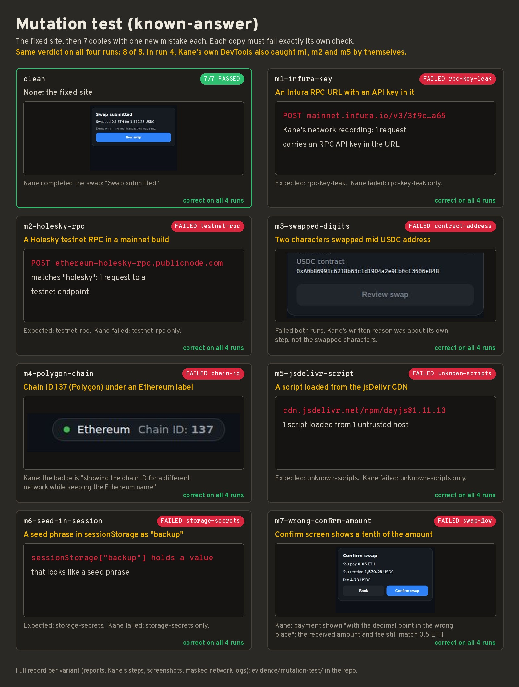
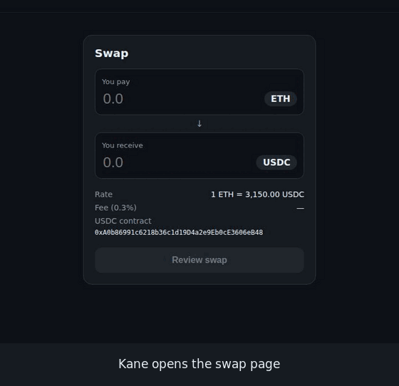
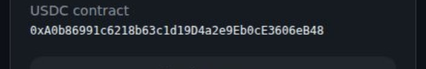
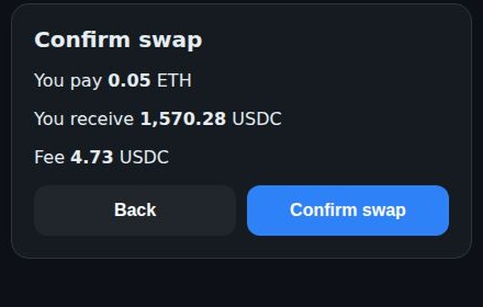
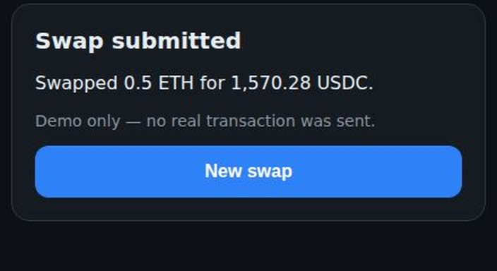

# DappSentinel: the full details

The reference material from the [README](README.md), word for word: every table, run and honest note. Kane's output for every run linked here is kept in [`evidence/ci-runs/`](evidence/ci-runs/). The README keeps a short summary of each section, with a link here.

- [Who catches what: Kane and DappSentinel](#who-catches-what-kane-and-dappsentinel)
- [Why Kane CLI, and not Playwright plus a parser](#why-kane-cli-and-not-playwright-plus-a-parser)
- [Forensic trail: the loop on GitHub, step by step](#forensic-trail-the-loop-on-github-step-by-step)
- [Reproduce it yourself](#reproduce-it-yourself)
- [Track record](#track-record)
- [Mutation test (known-answer): mistakes it was never tuned for](#mutation-test-known-answer-mistakes-it-was-never-tuned-for)
- [Real-world runs](#real-world-runs)
- [Run it in CI](#run-it-in-ci)
- [Commands](#commands)
- [Findings for the Kane CLI team](#findings-for-the-kane-cli-team)
- [Repository layout](#repository-layout)
- [How the loop works: the rest](#how-the-loop-works-the-rest)
- [Built with](#built-with)
- [Notes](#notes)
- [Full version: What DappSentinel checks](#full-version-what-dappsentinel-checks)
- [Full version: Real-world loop: a bug in code we didn't write](#full-version-real-world-loop-a-bug-in-code-we-didnt-write)
- [Full version: Real-world loop 2: a bug reported on Polaris's issue tracker](#full-version-real-world-loop-2-a-bug-reported-on-polariss-issue-tracker)

## Who catches what: Kane and DappSentinel

Every check gets a verdict from Kane itself. Kane checks what a user can see by reading and using the page. For what a user can't see, Kane uses its own [DevTools assertions](https://www.testmuai.com/docs/kane-cli-checkpoint-devtools) on the network traffic and localStorage it captured. DappSentinel's code then reads Kane's recording line by line as a second, exact check. A check fails if either one finds the problem: a security gate fails closed.

| Check | Kane's own verdict | DappSentinel's exact check |
|---|---|---|
| Wrong contract address | **Kane**, reading the page | |
| Wrong chain ID | **Kane**, reading the network badge | |
| Main flow broken | **Kane**, using the swap like a person | The amount Kane itself read on the confirmation must be exactly 0.5 ETH |
| RPC key leaked | **Kane**, DevTools network assertion | Every request in Kane's recording |
| Testnet endpoint | **Kane**, DevTools network assertion | Every request in Kane's recording |
| Untrusted script | **Kane**, DevTools network assertion | Every script in Kane's recording |
| Keys in browser storage | **Kane**, DevTools localStorage assertion | localStorage and sessionStorage of the browser Kane drove |

**How the two verdicts compare, measured, not claimed:**
- **Demo with the six mistakes:** Kane's DevTools assertions failed all 4 hidden checks on their own, and DappSentinel agreed on all 4 ([run](https://github.com/Guzman0/DappSentinel/actions/runs/45023773746)). On a later run (23 Nov) they failed 3 of 4: Kane's assertion on testnet requests passed although the page called the Sepolia RPC, and DappSentinel's exact check caught it from Kane's own recording ([run](https://github.com/Guzman0/DappSentinel/actions/runs/45208847205)). The verdict was the same: 6 of 7 failed. A run later that day was 4 of 4 again ([run](https://github.com/Guzman0/DappSentinel/actions/runs/45210910500)).
- **Mutation test, run 4:** Kane's assertions caught 3 of the 4 hidden mistakes by themselves: the Infura key, the Holesky RPC and the jsDelivr script. The fourth, a seed phrase in sessionStorage, is outside what Kane's DevTools can read (they cover localStorage, not sessionStorage), and DappSentinel's exact check caught it. 8 of 8 judged correctly ([run](https://github.com/Guzman0/DappSentinel/actions/runs/45023763082)).
- **What changed between runs 3 and 4:** Kane's network capture resets at every step, so a script that loads only while the page opens was invisible to an assertion in a later step. Kane now stores the page's requests in the step that reloads it and asserts on that list. That turned Kane's miss on the jsDelivr script into a catch.
- **No false alarms from Kane:** on the clean site, and on Lido's live site, every Kane DevTools verdict matched DappSentinel's ([Lido run](https://github.com/Guzman0/DappSentinel/actions/runs/45023768462)).

That's why both run: Kane's verdicts come from Kane, and the exact check makes sure nothing slips past either. Every report shows both side by side, with a link to Kane's own replay. Each network finding also says where it sits in Kane's run, for example *"first seen in Kane's recording as request 5 of 6"*.

## Why Kane CLI, and not Playwright plus a parser

A fair question: the network and storage checks read files. Couldn't a scripted browser produce them?

For one site you wrote the script for, yes. What a script can't do is use a dApp it has never seen. Kane takes a plain-English objective and works the page out for itself, so the same checks run on any dApp with no per-site code:

- **On Aave's USDC market**, Kane found and dismissed a notice banner on its own, then confirmed the page is USDC on Ethereum and shows a supply APY and the total supplied ([run](https://github.com/Guzman0/DappSentinel/actions/runs/44834742720)). Nobody wrote selectors for that page.
- **On Lido's stake screen**, Kane dismissed Lido's banner, filled in the stake form and confirmed it quotes 1 ETH = 1 stETH, shows an APR and says it's on Ethereum ([run](https://github.com/Guzman0/DappSentinel/actions/runs/44835470086)).
- **On the demo**, Kane runs the swap and judges what the page shows: the contract address, the chain on the network badge, the confirmation. These are Kane's verdicts, not string matches.

Kane does three jobs here:

1. **It decides what passes.** Contract address, chain ID, the swap flow and the live-dApp screens are Kane assertions (`checks/03`, `04`, `07`, and `profiles/lido`, `profiles/aave`).
2. **It produces the evidence.** The network and storage checks read what Kane recorded while it used the page like a person. The recording only means something because a real user flow happened.
3. **It tells the agent what's wrong.** Kane's verdicts and summaries are what Claude Code reads before it fixes the site.

When Kane can't reach the real page (Lido's bot protection challenged GitHub's runner once), DappSentinel reports the checks as inconclusive instead of guessing ([run](https://github.com/Guzman0/DappSentinel/actions/runs/44834739399)).

## Forensic trail: the loop on GitHub, step by step

Every claim about the closed loop, with the artifact that proves it. From [PR #7](https://github.com/Guzman0/DappSentinel/pull/7), a copy change made on top of the broken demo:

| Step | What happened | Evidence |
|---|---|---|
| 1 | Kane fails the pull request: 6 of 7 | [The `gate` job](https://github.com/Guzman0/DappSentinel/actions/runs/44831840406/job/136618434622) |
| 2 | Claude Code receives Kane's report | [The `fix` job](https://github.com/Guzman0/DappSentinel/actions/runs/44831840406/job/136620210863): it downloads the gate's report, the prompt is in the log, and Claude's steps are in the run summary |
| 3 | Claude changes the site, and only the site | [The fix commit](https://github.com/Guzman0/DappSentinel/commit/f89938ad734d4633e7c2760f21d897dff42998c7): 2 files, both in `demo-dapp/` |
| 4 | Claude explains what it changed | [Its summary on the PR](https://github.com/Guzman0/DappSentinel/pull/7#issuecomment-7052572418), redacted like every report |
| 5 | Kane checks again and passes: 7 of 7 | [The re-check](https://github.com/Guzman0/DappSentinel/actions/runs/44833318875) |
| 6 | The agent can't change the rules | The `fix` job refuses to commit anything outside `demo-dapp/`. And in [PR #6](https://github.com/Guzman0/DappSentinel/pull/6), a check was edited instead of the site: the gate [refused to run](https://github.com/Guzman0/DappSentinel/actions/runs/44831572149), the auto-fix never started, and the merge stays blocked |

Honest note: PR #7's first re-check ([run](https://github.com/Guzman0/DappSentinel/actions/runs/44832463609)) failed because Kane pressed Confirm swap before checking the confirmation, and DappSentinel then treated the valid network results as unproven. Both were fixed ([commit](https://github.com/Guzman0/DappSentinel/commit/72c2bac)) before the passing re-check. [PR #5](https://github.com/Guzman0/DappSentinel/pull/5) shows the same loop with no interruption.

## Reproduce it yourself

Each step says what you should see, and links a public run where it already happened.

| Step | Command | Expected result | Public run |
|---|---|---|---|
| 1. Check the broken demo | `npm install` → `kane-cli login` → `npm run sentinel` | ❌ 6 of 7 checks fail (only the swap flow passes), exit code 1 | [main, 6 of 7 failed](https://github.com/Guzman0/DappSentinel/actions/runs/44757974669) |
| 2. Let Claude Code fix it | Open the folder in Claude Code and run `/sentinel` | Claude fixes `demo-dapp/`, the Stop hook re-runs Kane, round 2 passes 7 of 7 | Shown in the [demo video](https://youtu.be/FiErWhY495U); the same fixes are in [PR #1](https://github.com/Guzman0/DappSentinel/pull/1) |
| 3. Try to cheat | Ask Claude to edit `checks/04-chain-id.md`, or edit it yourself and run `npm run sentinel` | The edit is blocked; or the gate refuses to run (exit code 3) | Shown in the [demo video](https://youtu.be/FiErWhY495U) |
| 4. Fix in a pull request | Open a PR that fixes `demo-dapp/` | The `gate` check passes 7 of 7 | [PR #1, 7 of 7 passed](https://github.com/Guzman0/DappSentinel/actions/runs/44756869916) |
| 5. Break in a pull request | Open a PR that leaves the mistakes in | The `gate` check fails and the required check blocks the merge | [PR #2, 6 of 7 failed](https://github.com/Guzman0/DappSentinel/actions/runs/44794168901), merge blocked |
| 6. Let Claude fix it on GitHub | Open a PR that leaves the mistakes in, with `CLAUDE_CODE_OAUTH_TOKEN` set | The gate fails, Claude Code commits a fix to the PR, the gate re-runs and passes 7 of 7 | [PR #5](https://github.com/Guzman0/DappSentinel/pull/5): [red](https://github.com/Guzman0/DappSentinel/actions/runs/44819169522), then [green](https://github.com/Guzman0/DappSentinel/actions/runs/44819910638) |
| 7. Check a live dApp | `node bin/dappsentinel.js check --config profiles/live --url https://stake.lido.fi` | ✅ 5 of 5 pass | [Lido via the action](https://github.com/Guzman0/DappSentinel/actions/runs/44776723947) |

Reset the demo after step 2 with `npm run demo:reset`.

## Track record

Every CI run so far, unfiltered. Same input, same verdict.

| Input | Runs | Result |
|---|---|---|
| Demo with the six mistakes (`main`, PR #2) | [1](https://github.com/Guzman0/DappSentinel/actions/runs/44757974669), [2](https://github.com/Guzman0/DappSentinel/actions/runs/44777482670), [3](https://github.com/Guzman0/DappSentinel/actions/runs/44794168901) | ❌ 6 of 7 failed, every time |
| Demo with the fixes (PR #1) | [1](https://github.com/Guzman0/DappSentinel/actions/runs/44756869916), [2](https://github.com/Guzman0/DappSentinel/actions/runs/44777479949) | ✅ 7 of 7 passed, every time |
| Demo fixed by Claude Code on GitHub (PR #3, PR #5) | [#3 red](https://github.com/Guzman0/DappSentinel/actions/runs/44812319363) → [#3 green](https://github.com/Guzman0/DappSentinel/actions/runs/44813042427), [#5 red](https://github.com/Guzman0/DappSentinel/actions/runs/44819169522) → [#5 green](https://github.com/Guzman0/DappSentinel/actions/runs/44819910638) | ❌ 6 of 7, then ✅ 7 of 7 after Claude's fix, both times |
| Mutation test (known-answer): fixed site + 7 new mistakes | [1](https://github.com/Guzman0/DappSentinel/actions/runs/44847434698), [2](https://github.com/Guzman0/DappSentinel/actions/runs/44884542975) | ✅ 8 of 8 judged correctly, both times |
| An edited check (PR #6) | [1](https://github.com/Guzman0/DappSentinel/actions/runs/44831572149) | ⛔ refused to run, auto-fix not started |
| Lido | [1](https://github.com/Guzman0/DappSentinel/actions/runs/44762327264), [2](https://github.com/Guzman0/DappSentinel/actions/runs/44771371726), [3](https://github.com/Guzman0/DappSentinel/actions/runs/44776723947) | ✅ 5 of 5, every time since the "self" fix |
| CoW Swap | [1](https://github.com/Guzman0/DappSentinel/actions/runs/44760471120), [2](https://github.com/Guzman0/DappSentinel/actions/runs/44762331502) | ❌ keyed RPC URL and outside script hosts, both times |
| Aave | [1](https://github.com/Guzman0/DappSentinel/actions/runs/44759641283), [2](https://github.com/Guzman0/DappSentinel/actions/runs/44760476608) | ❌ scripts from `app.family.co` and Cloudflare Insights, both times |

Not counted above, and why: one Lido run ([run](https://github.com/Guzman0/DappSentinel/actions/runs/44770797794)) hit Cloudflare bot protection, which led to the "inconclusive" rule; one action test ([run](https://github.com/Guzman0/DappSentinel/actions/runs/44770752102)) ran before the `v1` tag existed; the first runs on Lido, CoW Swap and Aave ([1](https://github.com/Guzman0/DappSentinel/actions/runs/44759647200), [2](https://github.com/Guzman0/DappSentinel/actions/runs/44759652548)) were before two false-alarm fixes, described in [Real-world runs](#real-world-runs).

## Mutation test (known-answer): mistakes it was never tuned for

A gate is only useful if it's right. So we took the fixed site and made 7 copies, each with **one new mistake** that is different from the demo's (Infura instead of Alchemy, Holesky instead of Sepolia, a swapped digit in the middle of the address instead of the last one, and so on). The clean site must pass everything; each copy must fail exactly its own check and nothing else.

**Four runs, same verdict every time: 8 of 8** ([run 1](https://github.com/Guzman0/DappSentinel/actions/runs/44847434698) · [run 2](https://github.com/Guzman0/DappSentinel/actions/runs/44884542975) · [run 3](https://github.com/Guzman0/DappSentinel/actions/runs/44962415067) · [run 4](https://github.com/Guzman0/DappSentinel/actions/runs/45023763082)). Runs 3 and 4 also record Kane's own DevTools verdicts on the 4 hidden mistakes. In run 3 Kane caught 2 of them by itself and missed the jsDelivr script and the seed in sessionStorage. We fixed how Kane captures the page's requests, and in run 4 it caught 3 of 4. Kane's DevTools can't read sessionStorage, so that one is always caught by DappSentinel's exact check.



| Variant | Planted mistake | Expected | Run 1 | Run 2 | Run 3 | Run 4 | What Kane found |
|---|---|---|---|---|---|---|---|
| `clean` | None: the fixed site | 7 of 7 pass | ✅ | ✅ | ✅ | ✅ | Completed the swap; address and chain ID confirmed |
| `m1-infura-key` | Infura RPC URL with an API key | fail `rpc-key-leak` only | ✅ | ✅ | ✅ | ✅ | `POST mainnet.infura.io/v3/3f9c…a65` in its network recording |
| `m2-holesky-rpc` | Holesky testnet RPC in a mainnet build | fail `testnet-rpc` only | ✅ | ✅ | ✅ | ✅ | A request to `ethereum-holesky-rpc.publicnode.com` |
| `m3-swapped-digits` | Two characters swapped mid USDC address | fail `contract-address` only | ✅ | ✅ | ✅ | ✅ | Failed it both times, but its written reason was about its own step (see below) |
| `m4-polygon-chain` | Chain ID 137 under an Ethereum label | fail `chain-id` only | ✅ | ✅ | ✅ | ✅ | "showing the chain ID for a different network while keeping the Ethereum name" |
| `m5-jsdelivr-script` | Script from the jsDelivr CDN | fail `unknown-scripts` only | ✅ | ✅ | ✅ | ✅ | 1 script from 1 untrusted host, `cdn.jsdelivr.net` |
| `m6-seed-in-session` | Seed phrase in sessionStorage as `backup` | fail `storage-secrets` only | ✅ | ✅ | ✅ | ✅ | `sessionStorage["backup"]` holds a seed phrase |
| `m7-wrong-confirm-amount` | Confirm screen shows a tenth of the amount | fail `swap-flow` only | ✅ | ✅ | ✅ | ✅ | The decimal point is in the wrong place; received amount and fee still match 0.5 ETH |

### What Kane saw (its own screenshots)

Two of the swap-flow runs from mutation test run 4, played back from Kane's own step screenshots. The red boxes are Kane's, marking what it is about to type into or click. The captions follow Kane's step log, and the last card gives the verdict (for the catch, in Kane's own words).

<table>
<tr>
<td width="50%">

**A clean pass** (`clean`): Kane completes the swap and every assertion holds.


*Source: [`clean/screenshots/`](evidence/mutation-test/run-45023763082/clean/screenshots/)*

</td>
<td width="50%">

**A mistake caught** (`m7-wrong-confirm-amount`): the confirmation shows 0.05 ETH for a 0.5 ETH swap, and Kane fails the run.



*Source: [`m7-wrong-confirm-amount/screenshots/`](evidence/mutation-test/run-45023763082/m7-wrong-confirm-amount/screenshots/)*

</td>
</tr>
</table>


Cropped from Kane's step screenshots in run 2. The full, uncropped sets are in [`evidence/mutation-test/run-44884542975/`](evidence/mutation-test/run-44884542975/).

| | |
|---|---|
| <br><sub>**m3:** the USDC address on the page reads `…c6218b63c1…`. The real one is `…c6218b36c1…`. Kane failed the address check.</sub> | <br><sub>**m4:** the badge says Ethereum but Chain ID 137. Kane: "showing the chain ID for a different network while keeping the Ethereum name."</sub> |
| <br><sub>**m7:** the user typed 0.5 ETH, the confirmation says 0.05, while the 1,570.28 USDC received still matches 0.5. Kane failed the swap flow.</sub> | <br><sub>**clean:** the fixed site. Kane completed the swap: "Swapped 0.5 ETH for 1,570.28 USDC."</sub> |

**Honest note on Kane CLI 0.10.8:** on the day it came out, we ran the test against it. In one run Kane read "You pay 0.05 ETH" on the confirmation, stored it, and even wrote that it differs from 0.5 ETH, but still passed the check. It failed it correctly on the next two runs. So the swap check now has an exact check behind Kane's verdict: Kane stores the amount it reads, and a pass only stands if that reading is 0.5 ([the full story](evidence/mutation-test/#kane-cli-0108-released-22-nov-2026-and-one-miss)). We reported it to the Kane CLI team with the evidence: [LambdaTest/kane-cli#239](https://github.com/LambdaTest/kane-cli/issues/239). The team confirmed it: Kane read the amount correctly, but in that run it compared the two values as whole numbers, which dropped the decimals (0.05 → 0 and 0.5 → 0), so they matched. Other runs compared them as decimals, which is why it happened once in 3. A fix is coming, and they called the exact check a good workaround until then ([their reply](https://github.com/LambdaTest/kane-cli/issues/239#issuecomment-7098306114)).

**Honest note on m3:** the verdict is right and repeatable (fail on the swapped address, pass on the clean one, twice each), but Kane never wrote "these two characters differ". Both times it said its own comparison step hadn't stored the value it read. We count the verdict, not the explanation.

**Browse it:** the [session viewer](https://dappsentinel.netlify.app/dashboard/) shows every copy of the site with Kane's steps, screenshots, verdicts and diagnosis, read from these records.

**The full record**, kept in the repo after GitHub's artifacts expire: [`evidence/mutation-test/`](evidence/mutation-test/) has, for every variant, the report, every step Kane took, Kane's screenshots and the masked network log. Run 2's record was committed by the workflow itself. Run it yourself from the **Mutation test (known-answer)** workflow, or one variant at a time with `node scripts/mutants.js build <id>` and `node bin/dappsentinel.js check --site .mutants/<id>`.

## Real-world runs

The `live` profile, run from GitHub Actions on three live mainnet dApps on 20 Nov 2026. Each run is public: open it to see Kane's output.

| dApp | Result | What Kane's recording showed |
|---|---|---|
| [Lido](https://stake.lido.fi) | ✅ 5 of 5 passed ([run](https://github.com/Guzman0/DappSentinel/actions/runs/44762327264)) | 54 requests and 26 scripts, all clean. Nothing secret in browser storage. |
| Lido, with Kane using the stake screen (`profiles/lido`) | ✅ 6 of 6 passed ([run](https://github.com/Guzman0/DappSentinel/actions/runs/44835470086)) | Kane filled in the stake form and confirmed 1 ETH = 1 stETH, an APR, and Ethereum as the network. Then all 54 requests and 26 scripts were clean. |
| Aave, with Kane using the USDC market (`profiles/aave`) | 5 of 6 ([run](https://github.com/Guzman0/DappSentinel/actions/runs/44834742720)) | Kane confirmed USDC on Ethereum with a supply APY and total supplied. 202 requests with no keys or testnets; scripts from `app.family.co` and Cloudflare Insights as before. |
| [Aave](https://app.aave.com) | 4 of 5 ([run](https://github.com/Guzman0/DappSentinel/actions/runs/44760476608)) | 222 requests with no RPC keys or testnet endpoints. Scripts load from `app.family.co` and Cloudflare Insights. Family is Aave's own embedded-wallet infrastructure, so this flag only means it isn't on the allowlist. |
| [CoW Swap](https://swap.cow.fi) | 3 of 5 ([run](https://github.com/Guzman0/DappSentinel/actions/runs/44762331502)) | One request goes to an Alchemy RPC URL with an API key in it (masked in the report). Frontends often ship domain-restricted keys on purpose, so this is a prompt to check the key's restrictions, not proof of a leak. 14 scripts come from 11 outside hosts, mostly ads and analytics. |

**A wider sweep, 21 Nov 2026:** 8 more dApps whose website code is open source, same `live` profile.

| dApp | Result | What Kane's recording showed |
|---|---|---|
| [Spark](https://app.spark.fi) | 4 of 5 ([run](https://github.com/Guzman0/DappSentinel/actions/runs/44952359583)) | A request to an Alchemy RPC URL with the full API key in it (masked here), first seen as request 28 of 80. The same key is written into Spark's frontend code, which was public on GitHub under an MIT licence in 2024. |
| [Yearn](https://yearn.fi) | ✅ 5 of 5 ([run](https://github.com/Guzman0/DappSentinel/actions/runs/44951344497)) | 80 requests and 29 scripts, all clean |
| [Curve](https://www.curve.finance/dex/ethereum/swap) | ✅ 5 of 5 ([run](https://github.com/Guzman0/DappSentinel/actions/runs/44951350211)) | 199 requests and 177 scripts, all clean |
| [Uniswap](https://app.uniswap.org/swap) | 4 of 5 ([run](https://github.com/Guzman0/DappSentinel/actions/runs/44951361382)) | 1,002 requests with no keys or testnets. One script from Cloudflare Turnstile, its bot protection |
| [ENS](https://app.ens.domains) | 4 of 5 ([run](https://github.com/Guzman0/DappSentinel/actions/runs/44951371955)) | Clean traffic. Scripts from Cloudflare Insights and Intercom (support chat) |
| [Revoke.cash](https://revoke.cash) | 4 of 5 ([run](https://github.com/Guzman0/DappSentinel/actions/runs/44951383161)) | Clean traffic. Scripts from Cloudflare Insights and Crisp (support chat) |
| [Balancer](https://balancer.fi/swap/ethereum) | ⚠️ inconclusive ([run](https://github.com/Guzman0/DappSentinel/actions/runs/44951366707)) | The site's bot protection blocked the automated browser, so the network checks were marked inconclusive instead of passed |
| [Sushi](https://www.sushi.com/ethereum/swap) | ⚠️ inconclusive ([run](https://github.com/Guzman0/DappSentinel/actions/runs/44951355988)) | Kane stopped because the page couldn't scroll, which our browse instruction made conditional. Inconclusive, not passed |

Analytics, support-chat and bot-protection scripts are flagged because they aren't on the allowlist, not because they're malicious: a team adds the hosts it trusts to `allowedScriptHosts`.

Running on real sites made DappSentinel better:
- An early storage check mistook order hashes for private keys.
- "self" now trusts a site's own subdomains (`matomo.lido.fi` for `stake.lido.fi`).
- `app.spark.fi` forwards to `app.spark.finance`. The [first Spark run](https://github.com/Guzman0/DappSentinel/actions/runs/44951377736) flagged all 24 of Spark's own scripts and missed its storage. DappSentinel now follows the forward and counts the new address as the site itself; the [re-run](https://github.com/Guzman0/DappSentinel/actions/runs/44952359583) flags only the real key.

The demo itself also runs in CI: [`main` with the six mistakes](https://github.com/Guzman0/DappSentinel/actions/runs/44757974669) fails 6 of 7, and [the fix in PR #1](https://github.com/Guzman0/DappSentinel/actions/runs/44756869916) passes 7 of 7.

## Run it in CI

`.github/workflows/dappsentinel.yml` runs the gate on every pull request. The PR gets a red check while any check fails, the report appears in the run summary, and Kane's evidence is kept as an artifact.

**The loop closes on GitHub too.** When the gate fails on a pull request, Claude Code fixes the site in CI, commits the fix to the pull request, and Kane checks again. Only `demo-dapp/` may change (the workflow refuses to commit anything else, and the gate refuses edited rules), and it stops after 3 rounds. It needs one more secret, `CLAUDE_CODE_OAUTH_TOKEN`, made with `claude setup-token`. Add `DAPPSENTINEL_PUSH_TOKEN` too (a fine-grained token with Contents and Pull requests write access to this repo) and the fix commit starts the pull request's own gate, so the loop runs with no clicks at all. See it in [PR #5](https://github.com/Guzman0/DappSentinel/pull/5): Kane failed it 6 of 7, Claude Code fixed it on GitHub, and the PR's gate passed 7 of 7.

1. Add two repository secrets under **Settings > Secrets and variables > Actions**: `LT_USERNAME` (your TestMu AI username) and `LT_ACCESS_KEY` (your access key). In CI, Kane signs in with these instead of `kane-cli login`.
2. Open a pull request.

To check a live dApp from GitHub, open **Actions → DappSentinel → Run workflow** and paste its URL. That runs the `live` profile on it.

The referee is protected in CI too. If a pull request changes the checks, a config or the gate itself, DappSentinel compares them with the branch the PR targets and refuses to run, so a PR can't edit a check to pass its own gate.

## Commands

| Command | What it does |
|---|---|
| `npm run sentinel` | Run every check, write `.sentinel/report.md` and `.sentinel/report.json` |
| `npm run sentinel:headed` | Same, with a visible browser |
| `npm run sentinel -- --only rpc-key-leak,chain-id` | Run selected checks |
| `npm run demo` | Serve the demo dApp at http://localhost:4173 |
| `npm run demo:reset` | Put the six planted mistakes back after a fix |
| `npm run checks` | List the checks |
| `node bin/dappsentinel.js check --config profiles/live --url <url>` | Check any public dApp URL |
| `npm run deploy` | Run the gate, and deploy to Netlify only if it passes |

Exit codes: `0` all passed, `1` a check failed, `2` setup problem (Kane not installed or not signed in), `3` refused because the checks or the gate were changed.

Turn the Stop hook off for a session with `DAPPSENTINEL_HOOK=off`.

## Findings for the Kane CLI team

What building DappSentinel taught us about Kane CLI (0.10.7 and 0.10.8), each with the run or code that shows it.

- **A pass can contradict Kane's own reading.** On 0.10.8, Kane read "You pay 0.05 ETH", stored it, wrote that it differs from 0.5, and still passed "the confirmation shows You pay 0.5 ETH". Once in 3 runs; the other 2 failed correctly. Reported as [LambdaTest/kane-cli#239](https://github.com/LambdaTest/kane-cli/issues/239) and confirmed by the Kane CLI team: the comparison step treated both values as whole numbers (0.05 → 0, 0.5 → 0). A fix is coming ([their reply](https://github.com/LambdaTest/kane-cli/issues/239#issuecomment-7098306114)). Our workaround: ask Kane to store the value (`store … as confirm_pay_amount`) and check it exactly ([record](evidence/mutation-test/#kane-cli-0108-released-22-nov-2026-and-one-miss)).
- **Kane's own triage, and its summary, can contradict Kane's reading.** On the copy with two swapped digits, Kane stored the address it read correctly (`…c6218b63c1d…`) and failed the check, but its triage said the value was an unresolved placeholder, that "the requested address is present", and filed it as a test configuration bug, 98% confident. Its summary said the same. This happened on three runs, on 0.10.7 and 0.10.8 ([run 4 of the mutation test](https://github.com/Guzman0/DappSentinel/actions/runs/45023763082), [two more](https://github.com/Guzman0/DappSentinel/actions/runs/45174082470) [runs](https://github.com/Guzman0/DappSentinel/actions/runs/45175229208); [record](evidence/mutation-test/run-45175229208/m3-swapped-digits/)). An agent reading only the summary would be told to fix the test. On the wrong-amount copy the triage was right: "the confirmation screen displays the payment amount with its decimal point in the wrong place", an application defect, 99%. DappSentinel now shows Kane's diagnosis in every failed check's report, labelled as Kane's opinion, and adds a warning when it blames the test. It never changes the verdict. Reported to the Kane CLI team as [LambdaTest/kane-cli#245](https://github.com/LambdaTest/kane-cli/issues/245) (23 Nov).
- **Telling Kane what to name a stored value works.** Left to itself, Kane chose its own name (`confirmation_you_pay_amount_check`). Told "store it … as confirm_pay_amount", it used that name, so code can read it reliably ([run](https://github.com/Guzman0/DappSentinel/actions/runs/45052587659)).
- **Network capture resets at every step.** A script that loads only while the page opens was invisible to a DevTools assertion in a later step, so Kane missed the jsDelivr script in mutation run 3. Storing the requests in the reload step itself ("store … as page_requests") and asserting on that list fixed it in run 4 ([run 3](https://github.com/Guzman0/DappSentinel/actions/runs/44962415067), [run 4](https://github.com/Guzman0/DappSentinel/actions/runs/45023763082)).
- **DevTools assertions can read localStorage but not sessionStorage.** A seed phrase in sessionStorage is only caught by DappSentinel's own watch of the browser Kane drives ([m6 in the mutation test](#mutation-test-known-answer-mistakes-it-was-never-tuned-for)).
- **Kane stops at the first failed assertion.** With four checks in one objective, the ones after a failure get no verdict, so DappSentinel re-runs the unreached ones, up to 4 rounds (`bin/dappsentinel.js`).
- **Read the step from the remark, and expect varied status words.** In `--agent` output the step text we needed was in `remark`, and a passed step's status was not always `passed`. DappSentinel accepts `passed`, `success`, `done`, `completed` and `ok`, and treats anything else as inconclusive, never as a pass.
- **When Kane can't use a page, it ends "failed".** On Balancer (bot protection) and Sushi (a page that wouldn't scroll), that isn't evidence the site is broken, so DappSentinel reports those as inconclusive ([Balancer](https://github.com/Guzman0/DappSentinel/actions/runs/44951366707), [Sushi](https://github.com/Guzman0/DappSentinel/actions/runs/44951355988)).
- **Replay share links expire after 7 days.** Judging can outlast them, so every report and record here also keeps Kane's screenshots and steps in the repo.

## Repository layout

```text
demo-dapp/            The site being guarded: SentinelSwap, a simulated ETH to USDC swap page (plain HTML, CSS, JS)
checks/               One check per file, in plain English for Kane (assert, storage and network checks)
sentinel.config.json  What "correct" means: chain ID, contract addresses, trusted script hosts
bin/dappsentinel.js   The gate: runs every check with Kane CLI and writes .sentinel/report.md
lib/                  Reads Kane's network log (HAR) and the storage of the Chrome Kane drives;
                      integrity.js is the tamper check that refuses to run if the rules changed
hooks/                Claude Code hooks: sentinel-stop.js closes the loop, guard-checks.js blocks edits to the rules
.claude/              Hook settings and the /sentinel command
profiles/             Ready-made checks for live dApps: live (any site), lido, aave
action.yml            The GitHub Action: uses: Guzman0/DappSentinel@v1.3.0
.github/workflows/    The PR gate and fix job, the mutation test, the install tests, the Spark and Polaris loops
mutants/, scripts/    The mutation test: the clean site, the 7 planted mistakes, and the scripts that build and judge them
evidence/             Committed records of the mutation test and the real-world loops
test/                 npm test: the analyzers on recorded fixtures, no Kane credits needed
docs/                 The website (dappsentinel.netlify.app), its session viewer (docs/dashboard, built by scripts/build-dashboard.js) and the list of the demo's planted mistakes
assets/               Logos, screenshots and GIFs used in this README
```

## How the loop works: the rest

After 3 rounds that Kane still fails, the hook lets Claude stop and says so instead:

```text
DappSentinel: a person needs to look at this. Claude Code made 3 rounds of fixes and Kane still finds problems, so the loop stops here instead of trying forever.
Checks still failing:
- No RPC API keys in network requests
Kane's full report: .sentinel/report.md
```

### What happens when

| Situation | In Claude Code (Stop hook) | On GitHub (pull request) |
|---|---|---|
| Every check passes | Claude may finish: "all checks passed, clear to ship" | Green check, merge allowed |
| A check fails (rounds 1 to 3) | Claude is blocked with the message above and fixes `demo-dapp/` | The fix job hands Claude Kane's report, commits its fix to the PR and comments what changed; Kane checks again |
| Kane can't decide (the page didn't load, or bot protection) | Counted as a failure, never as a pass | Same: red check, never a fake green |
| Claude makes no change (the fix needs a person's decision) | Kane isn't re-run on an unchanged site. Claude may stop, with "a person needs to look at this" and Kane's report | [Comment](https://github.com/Guzman0/DappSentinel/pull/10#issuecomment-7081463817): a person needs to look, with Claude's reasoning |
| 3 rounds used and Kane still fails | Claude may stop, with "a person needs to look at this" and the checks still failing | [Comment](https://github.com/Guzman0/DappSentinel/pull/9#issuecomment-7081219978): a person needs to look; no more automatic fixes |
| A check, the config or the gate was edited | Blocked: "revert those files and fix the site instead" (gate exit code `3`) | Red check, and no fix job runs ([PR #6](https://github.com/Guzman0/DappSentinel/pull/6)) |
| Claude edits anything outside the site | Edits to the checks and the gate are blocked as Claude makes them (`hooks/guard-checks.js`) | The fix job refuses to commit and fails |
| Kane CLI isn't installed or signed in | Claude may stop, with "could not run Kane (setup problem)"; nothing is reported as safe | Red check (exit code `2`), no fix job |
| Site unchanged since the last pass | Kane isn't re-run, no credits used | Not applicable: every push is checked |
| A pull request from a fork | Not applicable | GitHub doesn't give forks the repository's secrets, so Kane can't run there and there is no automatic fix |

## Built with

The code was written by **Claude** (Anthropic) working as a coding agent (Claude Opus 5.5 in the final sessions), with Kane CLI as the browser that checks its work.

| Tool | What it does in DappSentinel |
|---|---|
| **Kane CLI** (`@testmuai/kane-cli`; tested on 0.10.7 and on 0.10.8, released 22 Nov) | Runs every check in a real Chrome, gives its own verdicts (page assertions and DevTools assertions), and records the network log (HAR), screenshots and replay links that are the evidence |
| **Claude Code** | Fixes the site: through the Stop hook and `/sentinel` locally, and on GitHub through [`anthropics/claude-code-action@v1`](https://github.com/anthropics/claude-code-action) with its default model |
| **Node.js** (20 in CI) | The gate (`bin/dappsentinel.js`) and the analyzers (`lib/`), with three small dependencies: `adm-zip` (reads Kane's evidence packs), `ws` (talks to Chrome), `cross-spawn` (starts Kane) |
| **Google Chrome**, over the Chrome DevTools Protocol | The browser Kane drives; DappSentinel reads its localStorage and sessionStorage live |
| **GitHub Actions** | The pull request gate, the fix job, the mutation test and the real-world runs |
| **Docker** | Builds and serves outside code (Polaris) in isolation, with no secrets |
| **Netlify** | Hosts the [site](https://dappsentinel.netlify.app) |

The demo site is plain HTML, CSS and JavaScript with no build step.

## Notes

- A full round is 4 Kane CLI runs and uses TestMu AI credits. New accounts get free credits.
- `npm test` runs the analyzers against a network log recorded by Kane, with no credits needed.
- Both secrets in the demo are fake on purpose: the Alchemy key was made up, and the private key is the public Hardhat test key (account #0). Never use it for real funds.
- Kane CLI's DevTools assertions read localStorage but not sessionStorage. DappSentinel reads both from the Chrome that Kane drives, so a key hidden in sessionStorage is still caught.
- DappSentinel checks what a browser can see. It doesn't replace a smart contract audit.

## Full version: What DappSentinel checks

DappSentinel is a pre-launch safety gate for dApp frontends. It uses [Kane CLI](https://github.com/LambdaTest/kane-cli) to open your site in a real browser and check what happens *behind* the page: every network request, every script, everything left in browser storage. When Kane catches a problem, your coding agent (Claude Code) gets the findings, fixes the code, and Kane checks again, until every check passes.

It blocks the release wherever it runs: Claude Code can't finish its turn while a check fails, a pull request gets a red check ([GitHub Action](README.md#use-it-in-your-own-repo)), and `npm run deploy` only deploys when every check passes.

These are the mistakes that look fine on screen and cost users money:

| Check | What gets caught | Who decides: Kane first, then DappSentinel's exact check |
|---|---|---|
| `rpc-key-leak` | RPC provider API keys (Alchemy, Infura, QuickNode…) in network requests | **Kane's own DevTools assertion** on the requests it captured; then DappSentinel's exact check of Kane's network log |
| `testnet-rpc` | A mainnet build still calling testnet, staging or localhost endpoints | **Kane's own DevTools assertion** on the requests it captured; then DappSentinel's exact check of Kane's network log |
| `unknown-scripts` | Scripts loaded from hosts you didn't approve, the way drainers get injected | **Kane's own DevTools assertion** on the scripts it captured; then DappSentinel's exact check of Kane's network log |
| `storage-secrets` | Private keys or seed phrases left in localStorage or sessionStorage | **Kane's own DevTools assertion** on localStorage; then DappSentinel's watch of localStorage and sessionStorage in the Chrome Kane drives |
| `contract-address` | A displayed contract address that doesn't match the real one | **Kane's verdict**, reading the page |
| `chain-id` | The app pointing at the wrong chain | **Kane's verdict**, reading the network badge |
| `swap-flow` | The core user flow breaking after the fixes | **Kane's verdict**, using the swap end to end; then an exact check on the amount Kane read |

### Why two kinds of check?

Kane is great at plain-English assertions about what's on the page, so the visible checks
(`contract-address`, `chain-id`, `swap-flow`) are Kane's verdicts alone. For the hidden problems,
Kane gives its own verdict with its DevTools assertions on the network requests and localStorage it
captured. DappSentinel's code then checks the same evidence exactly: it reads every request in the
network recording (HAR file) Kane saves, and watches localStorage and sessionStorage live in the
Chrome that Kane drives (`kane-cli --cdp-endpoint`). A check fails if either one finds the problem.
The second check matters because Kane's DevTools can't read sessionStorage and can miss a request,
as the [mutation test](#mutation-test-known-answer-mistakes-it-was-never-tuned-for) shows. Secrets are
masked in the report.

## Full version: Real-world loop: a bug in code we didn't write

Spark is a large DeFi lending app. Its web app's code (MIT licence) was public on GitHub in 2024, and [a copy](https://github.com/syt4sh1/spark-app) still is. One workflow, [one run](https://github.com/Guzman0/DappSentinel/actions/runs/44953030392), every job green:

1. **Kane caught it.** We built Spark's code unchanged and Kane used it in a real browser. Kane failed the page itself: *"The page tries to use an external Ethereum data service from the browser, but that service does not allow requests from this page's address. The app cannot load its required data and shows an error screen."* The cause, in the browser's own error: an Alchemy API key written into the source, locked to Spark's domain.
2. **Claude Code fixed it.** It removed the key from the source, made the RPC URL a setting (`VITE_MAINNET_RPC_URL`) with a keyless public fallback, and documented it. 3 lines in 2 files: [the patch](evidence/realworld-spark/run-44953030392/fix.patch).
3. **Kane proved it.** Rebuilt and checked again: the page loads, and none of the 46 requests carries a key or goes to a testnet.

The same key is still in Spark's production traffic: DappSentinel's [live scan of app.spark.fi](https://github.com/Guzman0/DappSentinel/actions/runs/44952359583) found it. Spark's repository is private now, so there's no pull request to offer; the key is masked throughout. To be precise about what kind of bug this is: the key only works from Spark's own domain, so it isn't proof of a leak (see [what DappSentinel doesn't do](README.md#what-dappsentinel-doesnt-do)). The bug is that the published code can't run anywhere else: every fork or self-hosted build shows an error screen until the key is replaced. Full record and honest notes: [`evidence/realworld-spark/`](evidence/realworld-spark/).

<a name="real-world-loop-2-a-bug-the-maintainers-reported"></a>

## Full version: Real-world loop 2: a bug reported on Polaris's issue tracker

[Polaris](https://github.com/PolarisQ-xyz/polaris-frontend) is an open-source prediction-market dApp. Issue [#118](https://github.com/PolarisQ-xyz/polaris-frontend/issues/118) says a production build with a missing setting still builds, and silently points the site at localhost and testnet. One workflow, [one run](https://github.com/Guzman0/DappSentinel/actions/runs/45015619019), every job green:

1. **Kane caught it.** We built Polaris exactly as the issue describes. Kane failed the page: *"The page tried to get market and account data from a local service, but that service was not accepting connections."* Kane's own DevTools assertion against local and testnet requests failed too.
2. **Claude Code fixed it the way the issue asks.** A production build with a missing setting now stops with an error naming it; the defaults stay for development; CI sets explicit values ([the patch](evidence/realworld-polaris/run-45015619019/fix.patch)).
3. **Proven twice.** The misconfigured build is now refused, naming all three settings, which is the issue's first acceptance criterion. A correctly configured build passes Kane's DevTools assertion: no request to localhost or a testnet.

**Offered upstream:** the tested fix is offered [in a comment on issue #118](https://github.com/PolarisQ-xyz/polaris-frontend/issues/118#issuecomment-7079526239) (22 Nov) (GitHub's issue page loads comments with JavaScript; the same comment as [public data](https://api.github.com/repos/PolarisQ-xyz/polaris-frontend/issues/comments/7079526239), readable without a browser), and the pull request follows once a maintainer assigns it. Full record and honest notes, including why the configured build still can't load Polaris's live data from a test copy: [`evidence/realworld-polaris/`](evidence/realworld-polaris/).
