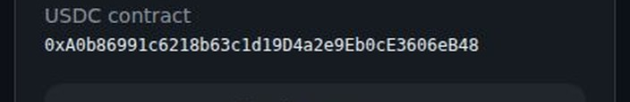

<p></p>

# DappSentinel

**The gate between your dApp and mainnet. Your dApp doesn't ship until Kane says it's safe.**

> [!TIP]
> **TL;DR**
> - **What:** a pre-launch gate for dApp websites. Kane CLI checks the site in a real browser for 6 mistakes you can't see on screen: leaked RPC keys, testnet endpoints, wrong contracts, wrong chain, untrusted scripts, keys in storage.
> - **The loop:** Kane catches it → Claude Code fixes it → Kane checks again, until every check passes. The agent can't edit the checks to cheat.
> - **Where it runs:** in Claude Code on your machine (`/sentinel`), and on GitHub, where it blocks the merge and fixes the pull request itself.
> - **Proof, all public:** broken PR blocked ([#2](https://github.com/Guzman0/DappSentinel/pull/2)) · Claude fixes a PR on GitHub with no human ([#5](https://github.com/Guzman0/DappSentinel/pull/5)) · cheating refused ([#6](https://github.com/Guzman0/DappSentinel/pull/6)) · 8 of 8 on a [mutation test (known-answer)](#mutation-test-known-answer-mistakes-it-was-never-tuned-for) with mistakes it was never tuned for · [forensic trail](#forensic-trail-the-loop-on-github-step-by-step) · live runs on Lido, Aave and CoW Swap ([results](#real-world-runs)).
> - **Install:** `uses: Guzman0/DappSentinel@v1.1.0` · **Site:** [dappsentinel.netlify.app](https://dappsentinel.netlify.app) · **Video:** [3:59](https://youtu.be/FiErWhY495U)

▶ **[Watch the demo video (3:59)](https://youtu.be/FiErWhY495U)**

## For judges

Every judging rule, and where to see the proof. Everything below is public; nothing needs a login or credits to read.

| Judging rule | Where to see it |
|---|---|
| **Bar: it works end to end** | [Reproduce it yourself](#reproduce-it-yourself) in 7 steps, each with a public run. The published action, used exactly as another repo would, on Lido: [run](https://github.com/Guzman0/DappSentinel/actions/runs/44909812956), 5 of 5, "Clear to ship" |
| **Bar: Kane caught or proved something** | Kane's own verdicts on 3 checks and its recording for the other 4 ([who catches what](#who-catches-what-kane-and-dappsentinel)). 6 planted mistakes caught on the demo ([run](https://github.com/Guzman0/DappSentinel/actions/runs/44757974669), [video at 1:26](https://youtu.be/FiErWhY495U?t=86)). 7 new mistakes it was never tuned for, [8 of 8 twice](#mutation-test-known-answer-mistakes-it-was-never-tuned-for). A keyed Alchemy RPC URL found on CoW Swap's live site ([real-world runs](#real-world-runs)) |
| **Bar: the agent and Kane talk** | Kane's findings go straight to Claude Code, and a Stop hook won't let Claude finish while a check fails ([how the loop works](#how-the-loop-works), [video at 1:52](https://youtu.be/FiErWhY495U?t=112)). On GitHub, the fix job hands Claude Kane's report, and the pull request gets a comment with what Claude changed ([PR #7](https://github.com/Guzman0/DappSentinel/pull/7#issuecomment-7052572418)) |
| **Ships** (25%) | Runs in Claude Code (`/sentinel`), from the command line, and as a GitHub Action ([`@v1.1.0`](https://github.com/Guzman0/DappSentinel/releases/tag/v1.1.0)). A required check blocks merging a broken pull request ([PR #2](https://github.com/Guzman0/DappSentinel/pull/2)) |
| **Verified** (25%) | [Mutation test](#mutation-test-known-answer-mistakes-it-was-never-tuned-for) with [Kane's own screenshots](#what-kane-saw-its-own-screenshots) and the full record in [`evidence/mutation-test/`](evidence/mutation-test/). Live mainnet dApps: Lido 6 of 6, Aave 5 of 6, CoW Swap 3 of 5 ([results](#real-world-runs)). Kane's own words are quoted in every report |
| **Closed loop** (25%) | Locally: Kane fails, Claude fixes, the Stop hook re-runs Kane, round 2 passes 7 of 7. On GitHub, with no human: Kane fails PR #5 6 of 7, Claude fixes and pushes, the PR's own check passes 7 of 7 ([forensic trail](#forensic-trail-the-loop-on-github-step-by-step)). Max 3 rounds. The agent [can't cheat](#the-agent-cant-cheat): editing a check is blocked, and the gate refuses to run ([PR #6](https://github.com/Guzman0/DappSentinel/pull/6)) |
| **Craft** (25%) | Two commands from any folder, with no clone ([try it on any dApp](#try-it-on-any-dapp-from-any-folder)). One line in a workflow: `uses: Guzman0/DappSentinel@v1.1.0` ([use it in your own repo](#use-it-in-your-own-repo)). One config file for your own dApp. Reports mask keys, and raw evidence is never uploaded by default ([SECURITY.md](SECURITY.md)). Honest limits in [what DappSentinel doesn't do](#what-dappsentinel-doesnt-do) |
| **Check it without credits** | `npm test` runs the analyzers on recorded fixtures. The [forensic trail](#forensic-trail-the-loop-on-github-step-by-step), the [track record](#track-record) and [`evidence/mutation-test/`](evidence/mutation-test/) are readable as they are |
| **Dates** | First commit `ed622c0`, 18 Nov 2026, after the 12 Nov start. The history is as written |

## Who catches what: Kane and DappSentinel

Kane checks what a user can see. Its recording captures what a user can't. DappSentinel reads that recording line by line.

| Check | Who spots it | The proof |
|---|---|---|
| Wrong contract address | **Kane**, reading the page | Kane's own verdict, in its words, and its screenshot |
| Wrong chain ID | **Kane**, reading the network badge | Kane's verdict and screenshot |
| Main flow broken | **Kane**, using the swap like a person | Kane's verdict and screenshot |
| RPC key leaked | DappSentinel, reading **Kane's network recording** | The exact request, where it sits in Kane's run, and a link to Kane's replay |
| Testnet endpoint | DappSentinel, reading **Kane's network recording** | The same |
| Untrusted script | DappSentinel, reading **Kane's network recording** | The same |
| Keys in browser storage | DappSentinel, reading **the browser Kane drove** | The storage entry, masked |

Why the last four are read by code: a page can send 200 requests, and none of them appear on screen. Plain code checks every one, the same way every time, and masks a real key before anything is saved. An AI skimming that much could miss one, and a missed key is the worst result a security gate can give. Kane's job is what only a real browser can do: use the dApp like a person, so the traffic it records is the traffic real users would cause.

Every report says where each network finding happened in Kane's run, for example *"first seen in Kane's recording as request 3 of 54, 6.2 s into Kane's run"*, and links Kane's own step-by-step replay of that run.

DappSentinel is a pre-launch safety gate for dApp frontends. It uses [Kane CLI](https://github.com/LambdaTest/kane-cli) to open your site in a real browser and check what happens *behind* the page: every network request, every script, everything left in browser storage. When Kane catches a problem, your coding agent (Claude Code) gets the findings, fixes the code, and Kane checks again, until every check passes.

It blocks the release wherever it runs: Claude Code can't finish its turn while a check fails, a pull request gets a red check ([GitHub Action](#use-it-in-your-own-repo)), and `npm run deploy` only deploys when every check passes.

These are the mistakes that look fine on screen and cost users money:

| Check | What gets caught | How Kane proves it |
|---|---|---|
| `rpc-key-leak` | RPC provider API keys (Alchemy, Infura, QuickNode…) in network requests | Network log Kane records in the browser |
| `testnet-rpc` | A mainnet build still calling testnet, staging or localhost endpoints | Network log Kane records in the browser |
| `unknown-scripts` | Scripts loaded from hosts you didn't approve, the way drainers get injected | Network log Kane records in the browser |
| `storage-secrets` | Private keys or seed phrases left in localStorage or sessionStorage | Kane drives a Chrome that DappSentinel watches live |
| `contract-address` | A displayed contract address that doesn't match the real one | Kane asserts on the page |
| `chain-id` | The app pointing at the wrong chain | Kane asserts on the page |
| `swap-flow` | The core user flow breaking after the fixes | Kane runs the flow end to end |

### Why two kinds of check?

Kane is great at plain-English assertions about what's on the page, so the visible checks
(`contract-address`, `chain-id`, `swap-flow`) are Kane assertions. The hidden problems live in
traffic and storage. Asking an agent to reason over a whole network log in one assertion tends to
time out, but Kane already records every request it sees in its evidence pack as a standard HAR
file. So while Kane runs the swap flow, DappSentinel reads that recording and checks every request
deterministically. Kane is still the one in the browser catching it; DappSentinel just reads the
tape.

Storage works the same way. DappSentinel starts Chrome, Kane drives it (`kane-cli --cdp-endpoint`),
and DappSentinel watches that browser's localStorage and sessionStorage live over the Chrome
DevTools Protocol while Kane uses the page. Secrets are masked in the report.

That's 4 Kane runs per round instead of 7, so each fix-and-verify loop is faster and cheaper.

## Why it matters

The demo video opens with three attacks that hit dApp websites, not smart contracts. Together they took about $1.62 billion from users.

| When | What happened | Lost | Source |
|---|---|---|---|
| Dec 2021 | BadgerDAO: a malicious script was injected into the website through a compromised Cloudflare API key | ~$120M | [The Block](https://www.theblock.co/post/126072/defi-protocol-badgerdao-exploited-for-120-million-in-front-end-attack) |
| Dec 2023 | Ledger Connect Kit: a poisoned npm release shipped a wallet drainer into dApps that load the library | ~$600K | [Ledger's incident report](https://www.ledger.com/blog/security-incident-report), [SlowMist](https://slowmist.medium.com/supply-chain-attack-on-ledger-connect-kit-analyzing-the-impact-and-preventive-measures-1005e39422fd) |
| Feb 2025 | Bybit: tampered JavaScript in the Safe{Wallet} web interface altered a multisig transaction | ~$1.5B | [The Block](https://www.theblock.co/post/343530/lazarus-appears-to-compromise-safe-developer-machine-in-lead-up-to-1-5-billion-bybit-hack-report), [SlowMist](https://slowmist.medium.com/bybits-1-5-billion-theft-unveiled-safe-wallet-front-end-code-tampered-84b78f0fa9c2) |

Figures are approximate and in US dollars at the time of each attack.

## Try it on any dApp, from any folder

No clone and no config. You need Node.js 20+, Chrome, and Kane CLI signed in (`npm i -g @testmuai/kane-cli && kane-cli login`):

```bash
npm install -g github:Guzman0/DappSentinel
dappsentinel check --url https://stake.lido.fi
```

It runs the 5 checks that need no inside knowledge of the site and writes `.sentinel/report.md`. This exact install, in an empty folder on a fresh GitHub runner, passed Lido 5 of 5: [run](https://github.com/Guzman0/DappSentinel/actions/runs/44925440855). `dappsentinel --help` lists the rest.

## Try it yourself in a minute

**Live demo dApp (deliberately vulnerable, the scan target):** https://sentinelswap-demo.netlify.app

This is SentinelSwap, the site DappSentinel checks, with all six mistakes still in it. It is not DappSentinel itself: DappSentinel runs from this repo, locally or in GitHub Actions.

It looks like a normal swap page. Open your browser's developer tools and you'll find the Alchemy key in the network tab, the unpkg script, the Sepolia RPC and `wallet_pk` in localStorage. Or let DappSentinel find them:

```bash
npm run sentinel -- --url https://sentinelswap-demo.netlify.app
```

Both secrets on that page are fake: the Alchemy key was made up and the private key is the public Hardhat test key.

## How the loop works

```
 Claude Code edits the site
          │
          ▼
 Stop hook runs DappSentinel ──► Kane CLI checks the site in a real browser
          ▲                                   │
          │                         all pass? ├── yes ──► ✅ clear to ship
          │                                   │
          └──── Kane's findings + fix hints ◄─┘ no
```

1. You (or Claude) change the site.
2. When Claude finishes its turn, a Claude Code **Stop hook** (`hooks/sentinel-stop.js`) runs every check with Kane CLI.
3. If anything fails, the hook **blocks Claude from finishing** and hands it Kane's report (`.sentinel/report.md`): what failed, the offending URLs or values, and how to fix it.
4. Claude fixes the code and finishes again, which re-runs the checks. This repeats until everything passes (or 5 rounds).
5. `npm run deploy` only deploys if every check passes.

## The agent can't cheat

The coding agent is allowed to fix the site. It is not allowed to touch the referee.

- A Claude Code **PreToolUse hook** (`hooks/guard-checks.js`) blocks any edit to `checks/`, `sentinel.config.json`, `bin/`, `lib/`, `hooks/` or `.claude/`, whether through the edit tools or a shell command like `sed -i` or `Set-Content`.
- The gate runs a **tamper check** first: if any of those files differ from the last commit, it refuses to run (exit code `3`) and lists them, and the Stop hook tells the agent to revert them.

So a red check can only turn green by changing the site.

## Quick start

You need [Node.js 18+](https://nodejs.org), Google Chrome and a free [TestMu AI](https://www.testmuai.com/kane-cli/) account.

```bash
# 1. Install Kane CLI and sign in
npm install -g @testmuai/kane-cli
kane-cli login

# 2. Get DappSentinel
git clone https://github.com/Guzman0/DappSentinel.git
cd DappSentinel
npm install

# 3. Run the gate against the included demo dApp
npm run sentinel
```

The demo dApp (`demo-dapp/`, a simulated ETH → USDC swap page) ships with real-world mistakes in it, so the first run fails and shows you what Kane catches. Open `.sentinel/report.md` to see the findings.

### Close the loop with Claude Code

```bash
npx @testmuai/kane-cli-skill   # optional: teaches Claude Code how to use Kane
claude                          # open Claude Code in this folder
```

Then ask: *"Run /sentinel and fix everything Kane catches."* Or change anything in `demo-dapp/` and let the Stop hook take over.

Want to watch Kane work? `npm run sentinel:headed` runs the checks in a visible browser.

## Use it on your own dApp

1. Point `siteDir` in `sentinel.config.json` at your site's build folder, or set `url` to your staging URL.
2. Set what "correct" means for your app:

```json
{
  "url": "https://staging.yourdapp.xyz",
  "chainId": 1,
  "networkName": "Ethereum",
  "contracts": { "USDC": "0xA0b86991c6218b36c1d19D4a2e9Eb0cE3606eB48" },
  "allowedScriptHosts": ["self", "cdn.yourdapp.xyz"]
}
```

3. Adjust the steps in `checks/*.md` to match your app's UI. Kane checks are plain English, so no test code is needed. `{{placeholders}}` are filled in from the config. Make sure `checks/07-swap-flow.md` walks through your main flow, because the network checks scan the traffic Kane records during it.

## Check any live dApp

The `live` profile runs the checks that work on any public site, with no access to its code: leaked RPC keys, testnet endpoints, untrusted scripts and secrets in browser storage. Kane browses the page while DappSentinel reads the traffic and storage.

```bash
node bin/dappsentinel.js check --config profiles/live --url https://app.yourdapp.xyz
```

Add the hosts you trust to `allowedScriptHosts` in `profiles/live/sentinel.config.json`, or every third-party script will be flagged.

## Use it in your own repo

DappSentinel is a GitHub Action. Add your TestMu AI username and access key as repository secrets (`LT_USERNAME`, `LT_ACCESS_KEY`), then add one step to a workflow:

```yaml
- uses: Guzman0/DappSentinel@v1.1.0
  with:
    url: https://staging.yourdapp.xyz
    lt-username: ${{ secrets.LT_USERNAME }}
    lt-access-key: ${{ secrets.LT_ACCESS_KEY }}
```

The step fails while any check fails, writes the report to the run summary and keeps it as an artifact. Other inputs:

- `site-dir`: check a folder you built (for example `dist`) instead of a URL. DappSentinel serves it locally.
- `config`: your own `sentinel.config.json`, with your chain ID, contract addresses and trusted script hosts, plus a `checksDir` for checks written for your UI. Without it, the `live` checks run, which work on any site.

If you pass `config` and check out with `fetch-depth: 0`, a pull request that changes your config or checks is refused, so a PR can't loosen the rules it is checked against.

## Why Kane CLI, and not Playwright plus a parser

A fair question: the network and storage checks read files. Couldn't a scripted browser produce them?

For one site you wrote the script for, yes. What a script can't do is use a dApp it has never seen. Kane takes a plain-English objective and works the page out for itself, so the same checks run on any dApp with no per-site code:

- **On Aave's USDC market**, Kane found and dismissed a notice banner on its own, then confirmed the page is USDC on Ethereum and shows a supply APY and the total supplied ([run](https://github.com/Guzman0/DappSentinel/actions/runs/44834742720)). Nobody wrote selectors for that page.
- **On Lido's stake screen**, Kane dismissed Lido's banner, filled in the stake form and confirmed it quotes 1 ETH = 1 stETH, shows an APR and says it's on Ethereum ([run](https://github.com/Guzman0/DappSentinel/actions/runs/44835470086)).
- **On the demo**, Kane runs the swap and judges what the page shows: the contract address, the chain on the network badge, the confirmation. These are Kane's verdicts, not string matches.

Kane does three jobs here:

1. **It decides what passes.** Contract address, chain ID, the swap flow and the live-dApp screens are Kane assertions (`checks/03`, `04`, `07`, and `profiles/lido`, `profiles/aave`).
2. **It produces the evidence.** The network and storage checks read what Kane recorded while it used the page like a person. The recording only means something because a real user flow happened.
3. **It tells the agent what's wrong.** Kane's verdicts and summaries are what Claude Code reads before it fixes the site.

When Kane can't reach the real page (Lido's bot protection challenged GitHub's runner once), DappSentinel reports the checks as inconclusive instead of guessing ([run](https://github.com/Guzman0/DappSentinel/actions/runs/44834739399)).

## Forensic trail: the loop on GitHub, step by step

Every claim about the closed loop, with the artifact that proves it. From [PR #7](https://github.com/Guzman0/DappSentinel/pull/7), a copy change made on top of the broken demo:

| Step | What happened | Evidence |
|---|---|---|
| 1 | Kane fails the pull request: 6 of 7 | [The `gate` job](https://github.com/Guzman0/DappSentinel/actions/runs/44831840406/job/136618434622) |
| 2 | Claude Code receives Kane's report | [The `fix` job](https://github.com/Guzman0/DappSentinel/actions/runs/44831840406/job/136620210863): it downloads the gate's report, the prompt is in the log, and Claude's steps are in the run summary |
| 3 | Claude changes the site, and only the site | [The fix commit](https://github.com/Guzman0/DappSentinel/commit/f89938ad734d4633e7c2760f21d897dff42998c7): 2 files, both in `demo-dapp/` |
| 4 | Claude explains what it changed | [Its summary on the PR](https://github.com/Guzman0/DappSentinel/pull/7#issuecomment-7052572418), redacted like every report |
| 5 | Kane checks again and passes: 7 of 7 | [The re-check](https://github.com/Guzman0/DappSentinel/actions/runs/44833318875) |
| 6 | The agent can't change the rules | The `fix` job refuses to commit anything outside `demo-dapp/`. And in [PR #6](https://github.com/Guzman0/DappSentinel/pull/6), a check was edited instead of the site: the gate [refused to run](https://github.com/Guzman0/DappSentinel/actions/runs/44831572149), the auto-fix never started, and the merge stays blocked |

Honest note: PR #7's first re-check ([run](https://github.com/Guzman0/DappSentinel/actions/runs/44832463609)) failed because Kane pressed Confirm swap before checking the confirmation, and DappSentinel then treated the valid network results as unproven. Both were fixed ([commit](https://github.com/Guzman0/DappSentinel/commit/72c2bac)) before the passing re-check. [PR #5](https://github.com/Guzman0/DappSentinel/pull/5) shows the same loop with no interruption.

## Reproduce it yourself

Each step says what you should see, and links a public run where it already happened.

| Step | Command | Expected result | Public run |
|---|---|---|---|
| 1. Check the broken demo | `npm install` → `kane-cli login` → `npm run sentinel` | ❌ 6 of 7 checks fail (only the swap flow passes), exit code 1 | [main, 6 of 7 failed](https://github.com/Guzman0/DappSentinel/actions/runs/44757974669) |
| 2. Let Claude Code fix it | Open the folder in Claude Code and run `/sentinel` | Claude fixes `demo-dapp/`, the Stop hook re-runs Kane, round 2 passes 7 of 7 | Shown in the [demo video](https://youtu.be/FiErWhY495U); the same fixes are in [PR #1](https://github.com/Guzman0/DappSentinel/pull/1) |
| 3. Try to cheat | Ask Claude to edit `checks/04-chain-id.md`, or edit it yourself and run `npm run sentinel` | The edit is blocked; or the gate refuses to run (exit code 3) | Shown in the [demo video](https://youtu.be/FiErWhY495U) |
| 4. Fix in a pull request | Open a PR that fixes `demo-dapp/` | The `gate` check passes 7 of 7 | [PR #1, 7 of 7 passed](https://github.com/Guzman0/DappSentinel/actions/runs/44756869916) |
| 5. Break in a pull request | Open a PR that leaves the mistakes in | The `gate` check fails and the required check blocks the merge | [PR #2, 6 of 7 failed](https://github.com/Guzman0/DappSentinel/actions/runs/44794168901), merge blocked |
| 6. Let Claude fix it on GitHub | Open a PR that leaves the mistakes in, with `CLAUDE_CODE_OAUTH_TOKEN` set | The gate fails, Claude Code commits a fix to the PR, the gate re-runs and passes 7 of 7 | [PR #5](https://github.com/Guzman0/DappSentinel/pull/5): [red](https://github.com/Guzman0/DappSentinel/actions/runs/44819169522), then [green](https://github.com/Guzman0/DappSentinel/actions/runs/44819910638) |
| 7. Check a live dApp | `node bin/dappsentinel.js check --config profiles/live --url https://stake.lido.fi` | ✅ 5 of 5 pass | [Lido via the action](https://github.com/Guzman0/DappSentinel/actions/runs/44776723947) |

Reset the demo after step 2 with `npm run demo:reset`.

## Track record

Every CI run so far, unfiltered. Same input, same verdict.

| Input | Runs | Result |
|---|---|---|
| Demo with the six mistakes (`main`, PR #2) | [1](https://github.com/Guzman0/DappSentinel/actions/runs/44757974669), [2](https://github.com/Guzman0/DappSentinel/actions/runs/44777482670), [3](https://github.com/Guzman0/DappSentinel/actions/runs/44794168901) | ❌ 6 of 7 failed, every time |
| Demo with the fixes (PR #1) | [1](https://github.com/Guzman0/DappSentinel/actions/runs/44756869916), [2](https://github.com/Guzman0/DappSentinel/actions/runs/44777479949) | ✅ 7 of 7 passed, every time |
| Demo fixed by Claude Code on GitHub (PR #3, PR #5) | [#3 red](https://github.com/Guzman0/DappSentinel/actions/runs/44812319363) → [#3 green](https://github.com/Guzman0/DappSentinel/actions/runs/44813042427), [#5 red](https://github.com/Guzman0/DappSentinel/actions/runs/44819169522) → [#5 green](https://github.com/Guzman0/DappSentinel/actions/runs/44819910638) | ❌ 6 of 7, then ✅ 7 of 7 after Claude's fix, both times |
| Mutation test (known-answer): fixed site + 7 new mistakes | [1](https://github.com/Guzman0/DappSentinel/actions/runs/44847434698), [2](https://github.com/Guzman0/DappSentinel/actions/runs/44884542975) | ✅ 8 of 8 judged correctly, both times |
| An edited check (PR #6) | [1](https://github.com/Guzman0/DappSentinel/actions/runs/44831572149) | ⛔ refused to run, auto-fix not started |
| Lido | [1](https://github.com/Guzman0/DappSentinel/actions/runs/44762327264), [2](https://github.com/Guzman0/DappSentinel/actions/runs/44771371726), [3](https://github.com/Guzman0/DappSentinel/actions/runs/44776723947) | ✅ 5 of 5, every time since the "self" fix |
| CoW Swap | [1](https://github.com/Guzman0/DappSentinel/actions/runs/44760471120), [2](https://github.com/Guzman0/DappSentinel/actions/runs/44762331502) | ❌ keyed RPC URL and outside script hosts, both times |
| Aave | [1](https://github.com/Guzman0/DappSentinel/actions/runs/44759641283), [2](https://github.com/Guzman0/DappSentinel/actions/runs/44760476608) | ❌ scripts from `app.family.co` and Cloudflare Insights, both times |

Not counted above, and why: one Lido run ([run](https://github.com/Guzman0/DappSentinel/actions/runs/44770797794)) hit Cloudflare bot protection, which led to the "inconclusive" rule; one action test ([run](https://github.com/Guzman0/DappSentinel/actions/runs/44770752102)) ran before the `v1` tag existed; the first runs on Lido, CoW Swap and Aave ([1](https://github.com/Guzman0/DappSentinel/actions/runs/44759647200), [2](https://github.com/Guzman0/DappSentinel/actions/runs/44759652548)) were before two false-alarm fixes, described in [Real-world runs](#real-world-runs).

## Mutation test (known-answer): mistakes it was never tuned for

A gate is only useful if it's right. So we took the fixed site and made 7 copies, each with **one new mistake** that is different from the demo's (Infura instead of Alchemy, Holesky instead of Sepolia, a swapped digit in the middle of the address instead of the last one, and so on). The clean site must pass everything; each copy must fail exactly its own check and nothing else.

**Two runs, same verdict both times: 8 of 8.** [Run 1](https://github.com/Guzman0/DappSentinel/actions/runs/44847434698) · [Run 2](https://github.com/Guzman0/DappSentinel/actions/runs/44884542975)


| Variant | Planted mistake | Expected | Run 1 | Run 2 | What Kane found |
|---|---|---|---|---|---|
| `clean` | None: the fixed site | 7 of 7 pass | ✅ | ✅ | Completed the swap; address and chain ID confirmed |
| `m1-infura-key` | Infura RPC URL with an API key | fail `rpc-key-leak` only | ✅ | ✅ | `POST mainnet.infura.io/v3/3f9c…a65` in its network recording |
| `m2-holesky-rpc` | Holesky testnet RPC in a mainnet build | fail `testnet-rpc` only | ✅ | ✅ | A request to `ethereum-holesky-rpc.publicnode.com` |
| `m3-swapped-digits` | Two characters swapped mid USDC address | fail `contract-address` only | ✅ | ✅ | Failed it both times, but its written reason was about its own step (see below) |
| `m4-polygon-chain` | Chain ID 137 under an Ethereum label | fail `chain-id` only | ✅ | ✅ | "showing the chain ID for a different network while keeping the Ethereum name" |
| `m5-jsdelivr-script` | Script from the jsDelivr CDN | fail `unknown-scripts` only | ✅ | ✅ | 1 script from 1 untrusted host, `cdn.jsdelivr.net` |
| `m6-seed-in-session` | Seed phrase in sessionStorage as `backup` | fail `storage-secrets` only | ✅ | ✅ | `sessionStorage["backup"]` holds a seed phrase |
| `m7-wrong-confirm-amount` | Confirm screen shows a tenth of the amount | fail `swap-flow` only | ✅ | ✅ | The decimal point is in the wrong place; received amount and fee still match 0.5 ETH |

### What Kane saw (its own screenshots)

Cropped from Kane's step screenshots in run 2. The full, uncropped sets are in [`evidence/mutation-test/run-44884542975/`](evidence/mutation-test/run-44884542975/).

| | |
|---|---|
| <br><sub>**m3:** the USDC address on the page reads `…c6218b63c1…`. The real one is `…c6218b36c1…`. Kane failed the address check.</sub> | <br><sub>**m4:** the badge says Ethereum but Chain ID 137. Kane: "showing the chain ID for a different network while keeping the Ethereum name."</sub> |
| <br><sub>**m7:** the user typed 0.5 ETH, the confirmation says 0.05, while the 1,570.28 USDC received still matches 0.5. Kane failed the swap flow.</sub> | <br><sub>**clean:** the fixed site. Kane completed the swap: "Swapped 0.5 ETH for 1,570.28 USDC."</sub> |

**Honest note on m3:** the verdict is right and repeatable (fail on the swapped address, pass on the clean one, twice each), but Kane never wrote "these two characters differ". Both times it said its own comparison step hadn't stored the value it read. We count the verdict, not the explanation.

**The full record**, kept in the repo after GitHub's artifacts expire: [`evidence/mutation-test/`](evidence/mutation-test/) has, for every variant, the report, every step Kane took, Kane's screenshots and the masked network log. Run 2's record was committed by the workflow itself. Run it yourself from the **Mutation test (known-answer)** workflow, or one variant at a time with `node scripts/mutants.js build <id>` and `node bin/dappsentinel.js check --site .mutants/<id>`.

## Real-world runs

The `live` profile, run from GitHub Actions on three live mainnet dApps on 20 Nov 2026. Each run is public: open it to see Kane's output.

| dApp | Result | What Kane's recording showed |
|---|---|---|
| [Lido](https://stake.lido.fi) | ✅ 5 of 5 passed ([run](https://github.com/Guzman0/DappSentinel/actions/runs/44762327264)) | 54 requests and 26 scripts, all clean. Nothing secret in browser storage. |
| Lido, with Kane using the stake screen (`profiles/lido`) | ✅ 6 of 6 passed ([run](https://github.com/Guzman0/DappSentinel/actions/runs/44835470086)) | Kane filled in the stake form and confirmed 1 ETH = 1 stETH, an APR, and Ethereum as the network. Then all 54 requests and 26 scripts were clean. |
| Aave, with Kane using the USDC market (`profiles/aave`) | 5 of 6 ([run](https://github.com/Guzman0/DappSentinel/actions/runs/44834742720)) | Kane confirmed USDC on Ethereum with a supply APY and total supplied. 202 requests with no keys or testnets; scripts from `app.family.co` and Cloudflare Insights as before. |
| [Aave](https://app.aave.com) | 4 of 5 ([run](https://github.com/Guzman0/DappSentinel/actions/runs/44760476608)) | 222 requests with no RPC keys or testnet endpoints. Scripts load from `app.family.co` and Cloudflare Insights. Family is Aave's own embedded-wallet infrastructure, so this flag only means it isn't on the allowlist. |
| [CoW Swap](https://swap.cow.fi) | 3 of 5 ([run](https://github.com/Guzman0/DappSentinel/actions/runs/44762331502)) | One request goes to an Alchemy RPC URL with an API key in it (masked in the report). Frontends often ship domain-restricted keys on purpose, so this is a prompt to check the key's restrictions, not proof of a leak. 14 scripts come from 11 outside hosts, mostly ads and analytics. |

Running on real sites made DappSentinel better: an early storage check mistook order hashes for private keys, and "self" now trusts a site's own subdomains (`matomo.lido.fi` for `stake.lido.fi`).

The demo itself also runs in CI: [`main` with the six mistakes](https://github.com/Guzman0/DappSentinel/actions/runs/44757974669) fails 6 of 7, and [the fix in PR #1](https://github.com/Guzman0/DappSentinel/actions/runs/44756869916) passes 7 of 7.

## Run it in CI

`.github/workflows/dappsentinel.yml` runs the gate on every pull request. The PR gets a red check while any check fails, the report appears in the run summary, and Kane's evidence is kept as an artifact.

**The loop closes on GitHub too.** When the gate fails on a pull request, Claude Code fixes the site in CI, commits the fix to the pull request, and Kane checks again. Only `demo-dapp/` may change (the workflow refuses to commit anything else, and the gate refuses edited rules), and it stops after 3 rounds. It needs one more secret, `CLAUDE_CODE_OAUTH_TOKEN`, made with `claude setup-token`. Add `DAPPSENTINEL_PUSH_TOKEN` too (a fine-grained token with Contents and Pull requests write access to this repo) and the fix commit starts the pull request's own gate, so the loop runs with no clicks at all. See it in [PR #5](https://github.com/Guzman0/DappSentinel/pull/5): Kane failed it 6 of 7, Claude Code fixed it on GitHub, and the PR's gate passed 7 of 7.

1. Add two repository secrets under **Settings > Secrets and variables > Actions**: `LT_USERNAME` (your TestMu AI username) and `LT_ACCESS_KEY` (your access key). In CI, Kane signs in with these instead of `kane-cli login`.
2. Open a pull request.

To check a live dApp from GitHub, open **Actions → DappSentinel → Run workflow** and paste its URL. That runs the `live` profile on it.

The referee is protected in CI too. If a pull request changes the checks, a config or the gate itself, DappSentinel compares them with the branch the PR targets and refuses to run, so a PR can't edit a check to pass its own gate.

## Commands

| Command | What it does |
|---|---|
| `npm run sentinel` | Run every check, write `.sentinel/report.md` and `.sentinel/report.json` |
| `npm run sentinel:headed` | Same, with a visible browser |
| `npm run sentinel -- --only rpc-key-leak,chain-id` | Run selected checks |
| `npm run demo` | Serve the demo dApp at http://localhost:4173 |
| `npm run demo:reset` | Put the six planted mistakes back after a fix |
| `npm run checks` | List the checks |
| `node bin/dappsentinel.js check --config profiles/live --url <url>` | Check any public dApp URL |
| `npm run deploy` | Run the gate, and deploy to Netlify only if it passes |

Exit codes: `0` all passed, `1` a check failed, `2` setup problem (Kane not installed or not signed in), `3` refused because the checks or the gate were changed.

Turn the Stop hook off for a session with `DAPPSENTINEL_HOOK=off`.

## What DappSentinel doesn't do

For what DappSentinel collects, masks and uploads, see [SECURITY.md](SECURITY.md). In short: only a redacted report is kept, and Kane's raw evidence is never uploaded unless you opt in.

- **A flagged RPC key isn't proof of a leak.** Many dApps ship keys that only work from their own domain. Treat the finding as a prompt to check the key's restrictions.
- **A flagged script host isn't proof of an attack.** It means the host isn't on your allowlist. Look into it, then either trust it in your config or remove the script.
- **It isn't a smart contract audit.** It checks the website, not the contracts behind it.
- **It can't catch every frontend compromise.** It sees what the browser does while Kane uses the page. Malicious code that only wakes up for certain wallets or transactions, like the code in the Bybit attack, may stay quiet during a check.
- **Some sites block automated browsers.** When Kane can't reach the real page, DappSentinel reports the network checks as inconclusive, never as clean.

## Notes

- A full round is 4 Kane CLI runs and uses TestMu AI credits. New accounts get free credits.
- `npm test` runs the analyzers against a network log recorded by Kane, with no credits needed.
- Both secrets in the demo are fake on purpose: the Alchemy key was made up, and the private key is the public Hardhat test key (account #0). Never use it for real funds.
- Kane CLI's own localStorage reading timed out in our tests (even on the cookbook's example), so DappSentinel reads storage from the Chrome that Kane drives instead. Kane still does the browsing; the storage is read from its browser.
- DappSentinel checks what a browser can see. It doesn't replace a smart contract audit.

Built for the [Kane CLI Online Hackathon](https://www.kaneclihack.sh/) with Claude Code; Kane CLI verifies it, and Kane's result drives the fix. MIT licence.
