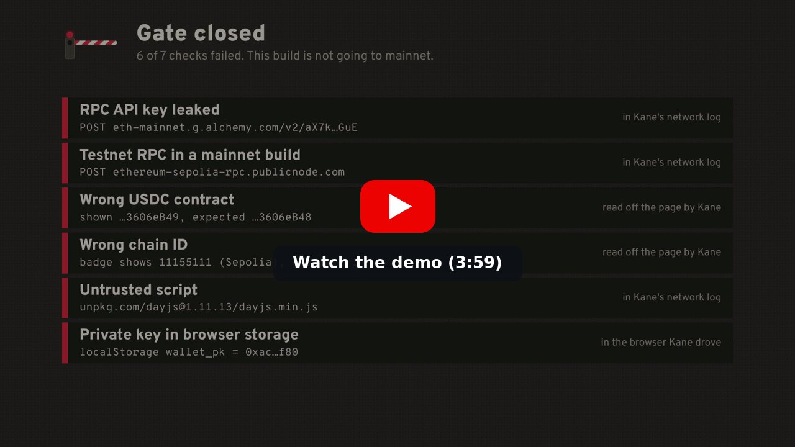
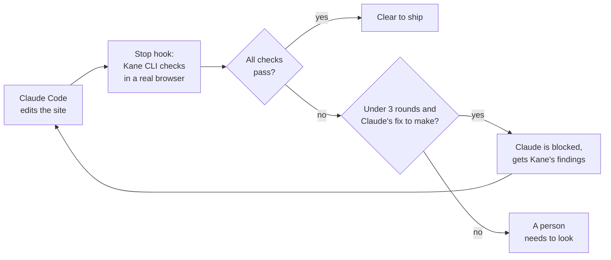
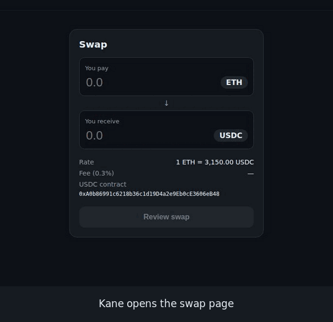

<p></p>

# DappSentinel

**The gate between your dApp and mainnet. Your dApp doesn't ship until Kane says it's safe.**

**For judges, in 60 seconds:** open the [demo site](https://sentinelswap-demo.netlify.app): it looks fine, but has 6 hidden mistakes. Open [PR #5](https://github.com/Guzman0/DappSentinel/pull/5): Kane fails it 6 of 7, Claude Code fixes it, and Kane passes it 7 of 7, with no human. Open [PR #10](https://github.com/Guzman0/DappSentinel/pull/10#issuecomment-7081463817): when the fix needs a person's decision, Claude stops and hands over. Then [Polaris #118](#real-world-loop-2-a-bug-reported-on-polariss-issue-tracker): a real bug reported on Polaris's own issue tracker, caught by Kane and fixed. To see every Kane run step by step, with Kane's screenshots, verdicts and diagnosis, open the [session viewer](https://dappsentinel.netlify.app/dashboard/). No login needed for any of it.

> [!TIP]
> **TL;DR**
> - **What:** a pre-launch gate for dApp websites. Kane CLI checks the site in a real browser for mistakes you can't see on screen: leaked RPC keys, testnet endpoints, wrong contracts, wrong chain, untrusted scripts, keys in storage.
> - **The loop:** Kane catches it → Claude Code fixes it → Kane checks again, until every check passes. The agent can't edit the checks to cheat, and after 3 rounds, or when only a person can decide, it hands over.
> - **Kane makes the call on all 7 checks**, with DevTools assertions for the hidden ones. An exact check runs behind it for what Kane's DevTools can't see ([who catches what](#who-catches-what-kane-and-dappsentinel)).
> - **Real bugs in code we didn't write:** [Polaris #118](#real-world-loop-2-a-bug-reported-on-polariss-issue-tracker) and [Spark](#real-world-loop-a-bug-in-code-we-didnt-write). Plus a [mutation test](#mutation-test-known-answer-mistakes-it-was-never-tuned-for), 8 of 8 on four runs, and [11 live dApps](#real-world-runs). And a bug in Kane CLI itself, [confirmed by the Kane team](https://github.com/LambdaTest/kane-cli/issues/239#issuecomment-7098306114).
> - **Install:** `uses: Guzman0/DappSentinel@v1.2.0` or `npm i -g github:Guzman0/DappSentinel` · **Site:** [dappsentinel.netlify.app](https://dappsentinel.netlify.app) · **Video:** [3:59](https://youtu.be/FiErWhY495U)

[](https://youtu.be/FiErWhY495U)

*Click to watch on YouTube (3:59).*

## See it work

On your machine, with [Node.js 20+](https://nodejs.org), Chrome and a free [TestMu AI](https://www.testmuai.com/kane-cli/) account:

```bash
npm install -g @testmuai/kane-cli && kane-cli login
git clone https://github.com/Guzman0/DappSentinel.git && cd DappSentinel && npm install
npm run sentinel     # ❌ 6 of 7 checks fail: Kane finds the demo's hidden mistakes
claude               # then type /sentinel: Claude fixes demo-dapp/, the Stop hook re-runs Kane, ✅ 7 of 7
```

Or watch it happen on GitHub with no human: Kane fails [PR #5](https://github.com/Guzman0/DappSentinel/pull/5) 6 of 7, Claude Code fixes it, and Kane passes it 7 of 7. Kane's own output from both runs and Claude's fix are kept in [`evidence/pr5-closed-loop/`](evidence/pr5-closed-loop/). Reset the demo with `npm run demo:reset`.

## Table of contents

- [See it work](#see-it-work)
- [For judges](#for-judges)
- [Kane's five jobs](#kanes-five-jobs)
- [Who catches what: Kane and DappSentinel](#who-catches-what-kane-and-dappsentinel)
- [Real-world loop: a bug in code we didn't write](#real-world-loop-a-bug-in-code-we-didnt-write)
- [Real-world loop 2: a bug reported on Polaris's issue tracker](#real-world-loop-2-a-bug-reported-on-polariss-issue-tracker)
- [What DappSentinel checks](#what-dappsentinel-checks)
  - [Why two kinds of check?](#why-two-kinds-of-check)
- [Why it matters](#why-it-matters)
- [Try it on any dApp, from any folder](#try-it-on-any-dapp-from-any-folder)
- [Try it yourself in a minute](#try-it-yourself-in-a-minute)
- [How the loop works](#how-the-loop-works)
  - [What Claude sees when Kane blocks it](#what-claude-sees-when-kane-blocks-it)
  - [What happens when](#what-happens-when)
- [The agent can't cheat](#the-agent-cant-cheat)
- [When the loop gives up, a person takes over](#when-the-loop-gives-up-a-person-takes-over)
- [Quick start](#quick-start)
  - [Close the loop with Claude Code](#close-the-loop-with-claude-code)
- [Use it on your own dApp](#use-it-on-your-own-dapp)
- [Check any live dApp](#check-any-live-dapp)
- [Use it in your own repo](#use-it-in-your-own-repo)
- [Why Kane CLI, and not Playwright plus a parser](#why-kane-cli-and-not-playwright-plus-a-parser)
- [Forensic trail: the loop on GitHub, step by step](#forensic-trail-the-loop-on-github-step-by-step)
- [Reproduce it yourself](#reproduce-it-yourself)
- [Track record](#track-record)
- [Mutation test (known-answer): mistakes it was never tuned for](#mutation-test-known-answer-mistakes-it-was-never-tuned-for)
  - [What Kane saw (its own screenshots)](#what-kane-saw-its-own-screenshots)
- [Real-world runs](#real-world-runs)
- [Run it in CI](#run-it-in-ci)
- [Commands](#commands)
- [What DappSentinel doesn't do](#what-dappsentinel-doesnt-do)
- [Findings for the Kane CLI team](#findings-for-the-kane-cli-team)
- [Repository layout](#repository-layout)
- [Built with](#built-with)
- [Notes](#notes)
- [Full details (DETAILS.md)](DETAILS.md)

## For judges

Every judging rule, and where to see the proof. All of it is public; nothing needs a login or credits. Every GitHub run linked in this README also has Kane's output copied into the repo, in [`evidence/ci-runs/`](evidence/ci-runs/), so none of the proof depends on a link.

| Judging rule | Where to see it |
|---|---|
| **Bar: it works end to end** | [Reproduce it yourself](#reproduce-it-yourself), 7 steps, each with a public run. The published action `@v1.2.0` on Lido, used exactly as another repo would: 5 of 5, "Clear to ship" ([run](https://github.com/Guzman0/DappSentinel/actions/runs/45211403304)) |
| **Bar: Kane caught or proved something** | Kane gives its own verdict on all 7 checks ([who catches what](#who-catches-what-kane-and-dappsentinel)). Two real bugs in code we didn't write: [Spark](#real-world-loop-a-bug-in-code-we-didnt-write) and [Polaris #118](#real-world-loop-2-a-bug-reported-on-polariss-issue-tracker). 6 planted mistakes on the demo ([run](https://github.com/Guzman0/DappSentinel/actions/runs/44757974669)), and 7 new ones it was never tuned for, [8 of 8 on four runs](#mutation-test-known-answer-mistakes-it-was-never-tuned-for) |
| **Bar: the agent and Kane talk** | Kane's findings go straight to Claude Code, and a Stop hook won't let Claude finish while a check fails ([how the loop works](#how-the-loop-works), [video at 1:52](https://youtu.be/FiErWhY495U?t=112)). On GitHub, Claude gets Kane's report and comments what it changed ([PR #7](https://github.com/Guzman0/DappSentinel/pull/7#issuecomment-7052572418)) |
| **Ships** (25%) | Claude Code (`/sentinel`), the command line, and a GitHub Action ([`@v1.2.0`](https://github.com/Guzman0/DappSentinel/releases/tag/v1.2.0)). A required check blocks merging a broken pull request ([PR #2](https://github.com/Guzman0/DappSentinel/pull/2)) |
| **Verified** (25%) | Polaris #118: caught, fixed as the issue asks, proven twice ([run](https://github.com/Guzman0/DappSentinel/actions/runs/45015619019)). Spark: caught, fixed, re-checked ([run](https://github.com/Guzman0/DappSentinel/actions/runs/44953030392)). The [mutation test](#mutation-test-known-answer-mistakes-it-was-never-tuned-for), with Kane's own screenshots, and [11 live dApps](#real-world-runs). It also found a bug in Kane CLI itself, [confirmed by the Kane team](https://github.com/LambdaTest/kane-cli/issues/239#issuecomment-7098306114) with a fix coming |
| **Closed loop** (25%) | With no human: Kane fails PR #5 6 of 7, Claude fixes and pushes, the PR passes 7 of 7 ([Kane's output and the fix](evidence/pr5-closed-loop/), [forensic trail](#forensic-trail-the-loop-on-github-step-by-step)). Max 3 rounds; when only a person can decide, Claude [hands over](#when-the-loop-gives-up-a-person-takes-over) ([PR #10](https://github.com/Guzman0/DappSentinel/pull/10#issuecomment-7081463817)). The agent [can't cheat](#the-agent-cant-cheat) ([PR #6](https://github.com/Guzman0/DappSentinel/pull/6)) |
| **Craft** (25%) | Two commands from any folder ([try it on any dApp](#try-it-on-any-dapp-from-any-folder)), or one line in a workflow ([use it in your own repo](#use-it-in-your-own-repo)). Keys masked in every report ([SECURITY.md](SECURITY.md)). Honest limits in [what DappSentinel doesn't do](#what-dappsentinel-doesnt-do) |
| **Check it without credits** | `npm test`, the [session viewer](https://dappsentinel.netlify.app/dashboard/), and [`evidence/`](evidence/): Kane's own output for every linked run ([`ci-runs/`](evidence/ci-runs/)), PR #5, Spark, Polaris and every mutation-test variant, kept in the repo |
| **Dates** | First commit `ed622c0`, 18 Nov 2026, after the 12 Nov start |

## Kane's five jobs

Kane CLI isn't only a test step here. It does five jobs, each with public proof.

1. **The gate.** Every check is a Kane run, and a failing check blocks the pull request or stops Claude from finishing ([PR #2](https://github.com/Guzman0/DappSentinel/pull/2)).
2. **The recorder.** Kane drives a real Chrome and records every request and script. That recording is the evidence the exact checks read, and each finding is traced back to its place in Kane's run ([who catches what](#who-catches-what-kane-and-dappsentinel)).
3. **The explorer.** On dApps it has never seen, Kane works out the screen and uses it like a person: it filled in Lido's stake form and read Aave's USDC market ([Lido run](https://github.com/Guzman0/DappSentinel/actions/runs/44835470086), [Aave run](https://github.com/Guzman0/DappSentinel/actions/runs/44834742720)).
4. **The inspector.** With its own DevTools assertions, Kane gives its own verdict on the problems you can't see on screen: leaked keys, testnet endpoints, untrusted scripts and keys in storage. In run 4 of the mutation test it caught 3 of the 4 by itself ([mutation test](#mutation-test-known-answer-mistakes-it-was-never-tuned-for)).
5. **The re-checker.** After Claude Code fixes something, Kane checks again, independently: locally through the Stop hook, on pull requests ([PR #5](https://github.com/Guzman0/DappSentinel/pull/5)), and on real code from Spark and Polaris ([Spark run](https://github.com/Guzman0/DappSentinel/actions/runs/44953030392), [Polaris run](https://github.com/Guzman0/DappSentinel/actions/runs/45015619019)). If Claude still can't get Kane to pass after 3 rounds, the loop stops and asks a person to look ([handover](#when-the-loop-gives-up-a-person-takes-over)).

## Who catches what: Kane and DappSentinel

Every check gets a verdict from Kane itself. Kane checks what a user can see by reading and using the page. For what a user can't see, Kane uses its own [DevTools assertions](https://www.testmuai.com/docs/kane-cli-checkpoint-devtools) on the network traffic and localStorage it captured. DappSentinel's code then reads Kane's recording line by line as a second, exact check. A check fails if either one finds the problem: a security gate fails closed.

| Check | Kane's own verdict | DappSentinel's exact check |
|---|---|---|
| Wrong contract address | **Kane**, reading the page | |
| Wrong chain ID | **Kane**, reading the network badge | |
| Main flow broken | **Kane**, using the swap like a person | The amount Kane itself read on the confirmation must be exactly 0.5 ETH |
| RPC key leaked | **Kane**, DevTools network assertion | Every request in Kane's recording |
| Testnet endpoint | **Kane**, DevTools network assertion | Every request in Kane's recording |
| Untrusted script | **Kane**, DevTools network assertion | Every script in Kane's recording |
| Keys in browser storage | **Kane**, DevTools localStorage assertion | localStorage and sessionStorage of the browser Kane drove |

**Measured, not claimed:** on the demo, Kane's DevTools assertions failed all 4 hidden checks by themselves in two of three runs ([run](https://github.com/Guzman0/DappSentinel/actions/runs/45023773746), [run](https://github.com/Guzman0/DappSentinel/actions/runs/45210910500)). In the third they failed 3 of 4: they missed the testnet request, and the exact check caught it ([run](https://github.com/Guzman0/DappSentinel/actions/runs/45208847205)). In mutation test run 4 they caught 3 of 4; the fourth, a seed phrase in sessionStorage (which Kane's DevTools can't read), was caught by the exact check ([run](https://github.com/Guzman0/DappSentinel/actions/runs/45023763082)). Kane raised no false alarms on the clean site or on Lido. Every report shows both verdicts side by side, with a link to Kane's own replay. [Full comparison](DETAILS.md#who-catches-what-kane-and-dappsentinel).

## Real-world loop: a bug in code we didn't write

Spark is a large DeFi lending app whose web app code (MIT licence) was public in 2024; [a copy](https://github.com/syt4sh1/spark-app) still is. [One run](https://github.com/Guzman0/DappSentinel/actions/runs/44953030392), every job green:

1. **Kane caught it.** We built Spark's code unchanged, and Kane failed the page: *"The page tries to use an external Ethereum data service from the browser, but that service does not allow requests from this page's address."* The cause: an Alchemy API key written into the source, locked to Spark's domain.
2. **Claude Code fixed it.** It made the RPC URL a setting with a keyless public fallback: 3 lines in 2 files ([the patch](evidence/realworld-spark/run-44953030392/fix.patch)).
3. **Kane proved it.** Rebuilt and checked again: the page loads, and none of the 46 requests carries a key or goes to a testnet.

To be precise: a domain-locked key isn't proof of a leak. The bug is that the published code can't run anywhere else, so every fork or self-hosted build shows an error screen. The same key is still in Spark's live traffic ([scan](https://github.com/Guzman0/DappSentinel/actions/runs/44952359583)), masked throughout. Full record: [`evidence/realworld-spark/`](evidence/realworld-spark/).

<a name="real-world-loop-2-a-bug-the-maintainers-reported"></a>

## Real-world loop 2: a bug reported on Polaris's issue tracker

[Polaris](https://github.com/PolarisQ-xyz/polaris-frontend) is an open-source prediction-market dApp. Issue [#118](https://github.com/PolarisQ-xyz/polaris-frontend/issues/118) says a production build with a missing setting still builds, and silently points the site at localhost and testnet. [One run](https://github.com/Guzman0/DappSentinel/actions/runs/45015619019), every job green:

1. **Kane caught it.** We built Polaris exactly as the issue describes. Kane failed the page (*"The page tried to get market and account data from a local service"*), and its DevTools assertion against local and testnet requests failed too.
2. **Claude Code fixed it the way the issue asks.** A production build with a missing setting now stops with an error naming it ([the patch](evidence/realworld-polaris/run-45015619019/fix.patch)).
3. **Proven twice.** The misconfigured build is refused, naming all three settings, and a correctly configured build passes Kane's DevTools assertion.

The tested fix is offered [on issue #118](https://github.com/PolarisQ-xyz/polaris-frontend/issues/118#issuecomment-7079526239) (also readable as [public data](https://api.github.com/repos/PolarisQ-xyz/polaris-frontend/issues/comments/7079526239)). Full record: [`evidence/realworld-polaris/`](evidence/realworld-polaris/).

## What DappSentinel checks

DappSentinel is a pre-launch safety gate for dApp frontends. It uses [Kane CLI](https://github.com/LambdaTest/kane-cli) to open your site in a real browser and check what happens *behind* the page: every network request, every script, everything left in browser storage. When Kane catches a problem, Claude Code gets the findings, fixes the code, and Kane checks again until every check passes. It blocks the release wherever it runs: in Claude Code, on a pull request ([GitHub Action](#use-it-in-your-own-repo)), and in `npm run deploy`.

These are the mistakes that look fine on screen and cost users money:

| Check | What gets caught | Who decides |
|---|---|---|
| `rpc-key-leak` | RPC provider API keys (Alchemy, Infura, QuickNode…) in network requests | Kane's DevTools assertion, then the exact check |
| `testnet-rpc` | A mainnet build still calling testnet, staging or localhost endpoints | Kane's DevTools assertion, then the exact check |
| `unknown-scripts` | Scripts from hosts you didn't approve, the way drainers get injected | Kane's DevTools assertion, then the exact check |
| `storage-secrets` | Private keys or seed phrases in localStorage or sessionStorage | Kane's DevTools assertion (localStorage), then the exact check (both) |
| `contract-address` | A displayed contract address that doesn't match the real one | Kane, reading the page |
| `chain-id` | The app pointing at the wrong chain | Kane, reading the network badge |
| `swap-flow` | The core user flow breaking after the fixes | Kane, using the swap; then an exact check on the amount it read |

### Why two kinds of check?

Kane is great at plain-English assertions about the page, so the visible checks are Kane's verdicts. For the hidden problems, Kane gives its verdict with DevTools assertions, and DappSentinel's code then checks the same evidence exactly: every request in the network log (HAR) Kane saves, and localStorage and sessionStorage in the Chrome Kane drives. A check fails if either one finds the problem. The second check matters because Kane's DevTools can't read sessionStorage and can miss a request, as the [mutation test](#mutation-test-known-answer-mistakes-it-was-never-tuned-for) shows. Secrets are masked in every report.

## Why it matters

The demo video opens with three attacks that hit dApp websites, not smart contracts. Together they took about $1.62 billion from users.

| When | What happened | Lost | Source |
|---|---|---|---|
| Dec 2021 | BadgerDAO: a malicious script was injected into the website through a compromised Cloudflare API key | ~$120M | [The Block](https://www.theblock.co/post/126072/defi-protocol-badgerdao-exploited-for-120-million-in-front-end-attack) |
| Dec 2023 | Ledger Connect Kit: a poisoned npm release shipped a wallet drainer into dApps that load the library | ~$600K | [Ledger's incident report](https://www.ledger.com/blog/security-incident-report), [SlowMist](https://slowmist.medium.com/supply-chain-attack-on-ledger-connect-kit-analyzing-the-impact-and-preventive-measures-1005e39422fd) |
| Feb 2025 | Bybit: tampered JavaScript in the Safe{Wallet} web interface altered a multisig transaction | ~$1.5B | [The Block](https://www.theblock.co/post/343530/lazarus-appears-to-compromise-safe-developer-machine-in-lead-up-to-1-5-billion-bybit-hack-report), [SlowMist](https://slowmist.medium.com/bybits-1-5-billion-theft-unveiled-safe-wallet-front-end-code-tampered-84b78f0fa9c2) |

Figures are approximate and in US dollars at the time of each attack.

## Try it on any dApp, from any folder

No clone and no config. You need Node.js 20+, Chrome, and Kane CLI signed in (`npm i -g @testmuai/kane-cli && kane-cli login`):

```bash
npm install -g github:Guzman0/DappSentinel
dappsentinel check --url https://stake.lido.fi
```

It runs the 5 checks that need no inside knowledge of the site and writes `.sentinel/report.md`. This exact install, in an empty folder on a fresh GitHub runner, passed Lido 5 of 5: [run](https://github.com/Guzman0/DappSentinel/actions/runs/44925440855). `dappsentinel --help` lists the rest.

## Try it yourself in a minute

**Live demo dApp (deliberately vulnerable, the scan target):** https://sentinelswap-demo.netlify.app

This is SentinelSwap, the site DappSentinel checks, with all six mistakes still in it. It is not DappSentinel itself: DappSentinel runs from this repo, locally or in GitHub Actions.

It looks like a normal swap page. Open your browser's developer tools and you'll find the Alchemy key in the network tab, the unpkg script, the Sepolia RPC and `wallet_pk` in localStorage. Or let DappSentinel find them:

```bash
npm run sentinel -- --url https://sentinelswap-demo.netlify.app
```

Both secrets on that page are fake: the Alchemy key was made up and the private key is the public Hardhat test key.

## How the loop works



1. You (or Claude) change the site.
2. When Claude finishes its turn, a Claude Code **Stop hook** (`hooks/sentinel-stop.js`) runs every check with Kane CLI.
3. If anything fails, the hook **blocks Claude from finishing** and hands it Kane's report (`.sentinel/report.md`): what failed, the offending URLs or values, and how to fix it.
4. Claude fixes the code and finishes again, which re-runs the checks. This repeats until everything passes. After 3 rounds, or when the fix needs a person's decision, it hands over to a person ([what happens when](#what-happens-when)).
5. `npm run deploy` only deploys if every check passes.

### What Claude sees when Kane blocks it

This is the hook's real output, word for word (it is JSON; the line breaks are shown here as lines). To capture it, we ran `hooks/sentinel-stop.js` on Kane's real report from mutation test run 4, where the demo site was given an Infura key ([report](evidence/mutation-test/run-45023763082/m1-infura-key/report.md)):

```text
decision: block
reason:
DappSentinel (Kane CLI) round 1/3: 1 of 7 checks failed.
- No RPC API keys in network requests: Kane's network recording shows 1 request carrying an RPC API key in the URL.

Read .sentinel/report.md for Kane's full findings and fix hints, fix the app in demo-dapp/, then finish your turn so the checks re-run.
Do not edit checks/ or sentinel.config.json to make a check pass.
```

Claude then reads Kane's report, which gives Kane's own verdict first, then the exact check's evidence and the fix (excerpt; the key is masked in every report):

```text
### ❌ No RPC API keys in network requests (`rpc-key-leak`)
Kane's own DevTools verdict: ❌ failed: assert: No URL in page_requests contains an RPC provider API key …
Kane and DappSentinel both found it.
DappSentinel's exact check: Kane's network recording shows 1 request carrying an RPC API key in the URL.
- POST https://mainnet.infura.io/v3/3f9c…a65  (first seen in Kane's recording as request 4 of 5)
How to fix: Remove provider API keys from frontend code. Use a keyless public RPC for read calls,
or route keyed calls through a server-side proxy. …
Watch Kane's run, step by step: https://test-manager.lambdatest.com/…
```

On GitHub, Claude gets the same report with [this prompt](.github/workflows/dappsentinel.yml), and both sides of the conversation end up on the pull request: Claude's summary of its fix ([PR #7](https://github.com/Guzman0/DappSentinel/pull/7#issuecomment-7052572418)) or its reason for handing over ([PR #10](https://github.com/Guzman0/DappSentinel/pull/10#issuecomment-7081463817)).

### What happens when

Every check passes: Claude may finish, and the pull request goes green. A check fails: Claude is blocked and fixes the site, up to 3 rounds. Kane can't decide (bot protection, a page that won't load): counted as a failure, never a pass. Claude makes no change, or 3 rounds are used: a person is asked to look. The rules were edited: the gate refuses to run. [All 10 situations, locally and on GitHub](DETAILS.md#what-happens-when).

## The agent can't cheat

The coding agent is allowed to fix the site. It is not allowed to touch the referee.

- A Claude Code **PreToolUse hook** (`hooks/guard-checks.js`) blocks any edit to `checks/`, `sentinel.config.json`, `bin/`, `lib/`, `hooks/` or `.claude/`, whether through the edit tools or a shell command like `sed -i` or `Set-Content`.
- The gate runs a **tamper check** first: if any of those files differ from the last commit, it refuses to run (exit code `3`) and lists them, and the Stop hook tells the agent to revert them.

So a red check can only turn green by changing the site.

## When the loop gives up, a person takes over

The fix loop never tries forever, and never quietly undoes what a developer meant to do. Claude Code is told what the pull request is for. If passing a check means undoing that, or a decision only a person may make (like trusting a new script host), Claude makes no change and explains why, and DappSentinel comments on the pull request: a person needs to look, here's what still fails, Claude's reasoning, and Kane's run. The same happens after 3 rounds, on GitHub and in the local Stop hook.

**A real handover, [PR #10](https://github.com/Guzman0/DappSentinel/pull/10)** (closed, not merged). The PR adds TradingView's price ticker, which loads 21 untrusted scripts. Kane failed 2 of 7. Claude kept the ticker, didn't touch the rules, and [explained](https://github.com/Guzman0/DappSentinel/pull/10#issuecomment-7081463817) that trusting TradingView is a person's decision ([run](https://github.com/Guzman0/DappSentinel/actions/runs/45038933982)). It also flagged one failure as a likely false alarm, now listed under [what DappSentinel doesn't do](#what-dappsentinel-doesnt-do).

**The 3-round limit, [PR #9](https://github.com/Guzman0/DappSentinel/pull/9)** (closed, not merged), with the three rounds **simulated** by empty commits: in [PR #8](https://github.com/Guzman0/DappSentinel/pull/8), even with 4 steps per round instead of 40, Claude fixed all six mistakes in round 1. On PR #9 the fix job counted 3 rounds and [handed over](https://github.com/Guzman0/DappSentinel/pull/9#issuecomment-7081219978) ([run](https://github.com/Guzman0/DappSentinel/actions/runs/45037005761)).

## Quick start

The four commands are in [See it work](#see-it-work). The demo dApp (`demo-dapp/`, a simulated ETH → USDC swap page) ships with six real-world mistakes, so the first run fails and `.sentinel/report.md` shows what Kane caught.

### Close the loop with Claude Code

Open Claude Code in the folder (`claude`) and ask: *"Run /sentinel and fix everything Kane catches."* Or change anything in `demo-dapp/` and let the Stop hook take over. `npx @testmuai/kane-cli-skill` optionally teaches Claude Code how to use Kane, and `npm run sentinel:headed` lets you watch Kane work.

## Use it on your own dApp

1. Point `siteDir` in `sentinel.config.json` at your site's build folder, or set `url` to your staging URL.
2. Set what "correct" means for your app:

```json
{
  "url": "https://staging.yourdapp.xyz",
  "chainId": 1,
  "networkName": "Ethereum",
  "contracts": { "USDC": "0xA0b86991c6218b36c1d19D4a2e9Eb0cE3606eB48" },
  "allowedScriptHosts": ["self", "cdn.yourdapp.xyz"]
}
```

3. Adjust the steps in `checks/*.md` to match your app's UI. Kane checks are plain English, so no test code is needed. `{{placeholders}}` are filled in from the config. Make sure `checks/07-swap-flow.md` walks through your main flow, because the network checks scan the traffic Kane records during it.

## Check any live dApp

The `live` profile runs the checks that work on any public site, with no access to its code: leaked RPC keys, testnet endpoints, untrusted scripts and secrets in browser storage. Kane browses the page while DappSentinel reads the traffic and storage.

```bash
node bin/dappsentinel.js check --config profiles/live --url https://app.yourdapp.xyz
```

Add the hosts you trust to `allowedScriptHosts` in `profiles/live/sentinel.config.json`, or every third-party script will be flagged.

## Use it in your own repo

DappSentinel is a GitHub Action. Add your TestMu AI username and access key as repository secrets (`LT_USERNAME`, `LT_ACCESS_KEY`), then add one step to a workflow:

```yaml
- uses: Guzman0/DappSentinel@v1.2.0
  with:
    url: https://staging.yourdapp.xyz
    lt-username: ${{ secrets.LT_USERNAME }}
    lt-access-key: ${{ secrets.LT_ACCESS_KEY }}
```

The step fails while any check fails, writes the report to the run summary and keeps it as an artifact. Other inputs:

- `site-dir`: check a folder you built (for example `dist`) instead of a URL. DappSentinel serves it locally.
- `config`: your own `sentinel.config.json`, with your chain ID, contract addresses and trusted script hosts, plus a `checksDir` for checks written for your UI. Without it, the `live` checks run, which work on any site.

If you pass `config` and check out with `fetch-depth: 0`, a pull request that changes your config or checks is refused, so a PR can't loosen the rules it is checked against.

## Why Kane CLI, and not Playwright plus a parser

A scripted browser can record the traffic of a site you wrote the script for. It can't use a dApp it has never seen. Kane takes a plain-English objective and works the page out itself: on Aave's USDC market it dismissed a banner and confirmed the market, supply APY and total supplied ([run](https://github.com/Guzman0/DappSentinel/actions/runs/44834742720)); on Lido it filled in the stake form and confirmed 1 ETH = 1 stETH ([run](https://github.com/Guzman0/DappSentinel/actions/runs/44835470086)). Nobody wrote selectors for either page. Kane decides what passes, produces the evidence the exact checks read, and tells Claude what's wrong. [The full answer](DETAILS.md#why-kane-cli-and-not-playwright-plus-a-parser).

## Forensic trail: the loop on GitHub, step by step

Every step of the closed loop on [PR #7](https://github.com/Guzman0/DappSentinel/pull/7), each with the artifact that proves it: Kane fails it 6 of 7 ([gate job](https://github.com/Guzman0/DappSentinel/actions/runs/44831840406/job/136618434622)), Claude Code gets Kane's report ([fix job](https://github.com/Guzman0/DappSentinel/actions/runs/44831840406/job/136620210863)), changes only `demo-dapp/` ([commit](https://github.com/Guzman0/DappSentinel/commit/f89938ad734d4633e7c2760f21d897dff42998c7)), explains it on the PR ([comment](https://github.com/Guzman0/DappSentinel/pull/7#issuecomment-7052572418)), and Kane passes it 7 of 7 ([re-check](https://github.com/Guzman0/DappSentinel/actions/runs/44833318875)). The same loop on [PR #5](https://github.com/Guzman0/DappSentinel/pull/5), with Kane's output kept in the repo: [`evidence/pr5-closed-loop/`](evidence/pr5-closed-loop/). [The full table, with an honest note](DETAILS.md#forensic-trail-the-loop-on-github-step-by-step).

## Reproduce it yourself

Seven steps, each with what you should see and a public run where it already happened: check the broken demo (6 of 7 fail), let Claude Code fix it, try to cheat, fix and break the demo in a pull request, let Claude fix it on GitHub ([PR #5](https://github.com/Guzman0/DappSentinel/pull/5)), and check a live dApp. [The step-by-step table](DETAILS.md#reproduce-it-yourself).

## Track record

Every CI run so far, unfiltered: same input, same verdict. The broken demo failed 6 of 7 on all 3 runs, the fixed demo passed 7 of 7 on both, Claude's fixes on GitHub turned red into green both times, and Lido passed 5 of 5 on every run. Each run's output is in [`evidence/ci-runs/`](evidence/ci-runs/). [Every run, and the ones not counted and why](DETAILS.md#track-record).

## Mutation test (known-answer): mistakes it was never tuned for

A gate is only useful if it's right. So we took the fixed site and made 7 copies, each with **one new mistake** that is different from the demo's (Infura instead of Alchemy, Holesky instead of Sepolia, a swapped digit in the middle of the address instead of the last one, and so on). The clean site must pass everything; each copy must fail exactly its own check and nothing else.

**Four runs, 8 of 8 every time** ([run 1](https://github.com/Guzman0/DappSentinel/actions/runs/44847434698) · [run 2](https://github.com/Guzman0/DappSentinel/actions/runs/44884542975) · [run 3](https://github.com/Guzman0/DappSentinel/actions/runs/44962415067) · [run 4](https://github.com/Guzman0/DappSentinel/actions/runs/45023763082)). In run 4, Kane's own DevTools assertions caught 3 of the 4 hidden mistakes by themselves.


| Variant | Planted mistake | Expected | Run 1 | Run 2 | Run 3 | Run 4 | What Kane found |
|---|---|---|---|---|---|---|---|
| `clean` | None: the fixed site | 7 of 7 pass | ✅ | ✅ | ✅ | ✅ | Completed the swap; address and chain ID confirmed |
| `m1-infura-key` | Infura RPC URL with an API key | fail `rpc-key-leak` only | ✅ | ✅ | ✅ | ✅ | `POST mainnet.infura.io/v3/3f9c…a65` in its network recording |
| `m2-holesky-rpc` | Holesky testnet RPC in a mainnet build | fail `testnet-rpc` only | ✅ | ✅ | ✅ | ✅ | A request to `ethereum-holesky-rpc.publicnode.com` |
| `m3-swapped-digits` | Two characters swapped mid USDC address | fail `contract-address` only | ✅ | ✅ | ✅ | ✅ | Failed it both times, but its written reason was about its own step (see below) |
| `m4-polygon-chain` | Chain ID 137 under an Ethereum label | fail `chain-id` only | ✅ | ✅ | ✅ | ✅ | "showing the chain ID for a different network while keeping the Ethereum name" |
| `m5-jsdelivr-script` | Script from the jsDelivr CDN | fail `unknown-scripts` only | ✅ | ✅ | ✅ | ✅ | 1 script from 1 untrusted host, `cdn.jsdelivr.net` |
| `m6-seed-in-session` | Seed phrase in sessionStorage as `backup` | fail `storage-secrets` only | ✅ | ✅ | ✅ | ✅ | `sessionStorage["backup"]` holds a seed phrase |
| `m7-wrong-confirm-amount` | Confirm screen shows a tenth of the amount | fail `swap-flow` only | ✅ | ✅ | ✅ | ✅ | The decimal point is in the wrong place; received amount and fee still match 0.5 ETH |

### What Kane saw (its own screenshots)

Two of the swap-flow runs from mutation test run 4, played back from Kane's own step screenshots. The red boxes are Kane's, marking what it is about to type into or click. The captions follow Kane's step log, and the last card gives the verdict (for the catch, in Kane's own words).

<table>
<tr>
<td width="50%">

**A clean pass** (`clean`): Kane completes the swap and every assertion holds.


*Source: [`clean/screenshots/`](evidence/mutation-test/run-45023763082/clean/screenshots/)*

</td>
<td width="50%">

**A mistake caught** (`m7-wrong-confirm-amount`): the confirmation shows 0.05 ETH for a 0.5 ETH swap, and Kane fails the run.



*Source: [`m7-wrong-confirm-amount/screenshots/`](evidence/mutation-test/run-45023763082/m7-wrong-confirm-amount/screenshots/)*

</td>
</tr>
</table>

**Honest note on Kane CLI 0.10.8:** in one run of three, Kane read "You pay 0.05 ETH", stored it, and still passed the check. So a pass now only stands if the amount Kane stored is exactly 0.5. Reported as [LambdaTest/kane-cli#239](https://github.com/LambdaTest/kane-cli/issues/239), and **confirmed by the Kane CLI team**: Kane read the amount correctly, but that run compared the numbers as whole numbers, so 0.05 and 0.5 both became 0. A fix is coming, and they called the exact check "a good" workaround ([their reply](https://github.com/LambdaTest/kane-cli/issues/239#issuecomment-7098306114)).

**Browse it** in the [session viewer](https://dappsentinel.netlify.app/dashboard/). Kane's screenshot of each mistake and the honest notes are in [the full write-up](DETAILS.md#mutation-test-known-answer-mistakes-it-was-never-tuned-for); every record is in [`evidence/mutation-test/`](evidence/mutation-test/).

## Real-world runs

The `live` profile on 11 live mainnet dApps on 20 and 21 Nov 2026, each a public run. Lido, Yearn and Curve passed 5 of 5 ([Lido](https://github.com/Guzman0/DappSentinel/actions/runs/44762327264)), and Kane also used Lido's stake screen and Aave's USDC market. Keyed Alchemy RPC URLs showed up on CoW Swap ([run](https://github.com/Guzman0/DappSentinel/actions/runs/44762331502)) and Spark ([run](https://github.com/Guzman0/DappSentinel/actions/runs/44952359583)). Most other flags were analytics, support-chat or bot-protection scripts that aren't on the allowlist. Balancer and Sushi stopped the automated browser, so they're reported inconclusive, never clean. Running on real sites also removed three false alarms. Kane's output for each is in [`evidence/ci-runs/`](evidence/ci-runs/). [Every dApp, with what Kane's recording showed](DETAILS.md#real-world-runs).

## Run it in CI

`.github/workflows/dappsentinel.yml` runs the gate on every pull request: a red check while any check fails, and the report in the run summary. Add `LT_USERNAME` and `LT_ACCESS_KEY` (your TestMu AI username and access key) as repository secrets. Add `CLAUDE_CODE_OAUTH_TOKEN` too, and Claude Code fixes the site on the pull request while Kane checks again, up to 3 rounds ([PR #5](https://github.com/Guzman0/DappSentinel/pull/5)). To check a live dApp, run the workflow by hand with its URL. [Setup details](DETAILS.md#run-it-in-ci).

## Commands

`npm run sentinel` runs every check, `npm run sentinel:headed` shows the browser, `npm run demo:reset` puts the six mistakes back, and `npm run deploy` deploys only if every check passes. Exit codes: `0` all passed, `1` a check failed, `2` setup problem, `3` refused because the rules were changed. [All commands](DETAILS.md#commands).

## What DappSentinel doesn't do

For what DappSentinel collects, masks and uploads, see [SECURITY.md](SECURITY.md). In short: only a redacted report is kept, and Kane's raw evidence is never uploaded unless you opt in.

- **A flagged RPC key isn't proof of a leak.** Many dApps ship keys that only work from their own domain. Treat the finding as a prompt to check the key's restrictions. Spark's key is exactly that kind: we don't call it a leak. Its bug is different: the published code can't run anywhere but Spark's own domain ([the Spark loop](#real-world-loop-a-bug-in-code-we-didnt-write)).
- **A flagged script host isn't proof of an attack.** It means the host isn't on your allowlist. Look into it, then either trust it in your config or remove the script.
- **It isn't a smart contract audit.** It checks the website, not the contracts behind it.
- **It can't catch every frontend compromise.** It sees what the browser does while Kane uses the page. Malicious code that only wakes up for certain wallets or transactions, like the code in the Bybit attack, may stay quiet during a check.
- **Some sites block automated browsers.** When Kane can't reach the real page, DappSentinel reports the network checks as inconclusive, never as clean.
- **Testing on `localhost` can trip the testnet check.** It matches words like `localhost` anywhere in a request's address, including where a third-party widget sends the page's own address, as in [PR #10](https://github.com/Guzman0/DappSentinel/pull/10). Check a deployed preview to avoid it.

## Findings for the Kane CLI team

What building DappSentinel taught us about Kane CLI 0.10.7 and 0.10.8. The top three:

- **A pass can contradict Kane's own reading.** Once in 3 runs on 0.10.8, Kane read "You pay 0.05 ETH" and still passed. Reported as [LambdaTest/kane-cli#239](https://github.com/LambdaTest/kane-cli/issues/239) and **confirmed by the Kane CLI team**: the comparison dropped the decimals, so 0.05 and 0.5 both became 0. A fix is coming ([their reply](https://github.com/LambdaTest/kane-cli/issues/239#issuecomment-7098306114)); our workaround is an exact check on the value Kane stores.
- **Kane's triage can blame the test when the app is wrong.** On the swapped-address copy, Kane failed the check correctly, but its triage called it a test configuration bug, 98% confident, on three runs ([record](evidence/mutation-test/run-45175229208/m3-swapped-digits/)). DappSentinel shows Kane's diagnosis labelled as Kane's opinion, warns when it blames the test, and never lets it change the verdict.
- **Network capture resets at every step, and DevTools can't read sessionStorage.** DappSentinel stores the page's requests in the step that reloads it, and watches sessionStorage itself.

[All 9 findings, each with its run](DETAILS.md#findings-for-the-kane-cli-team).

## Repository layout

`demo-dapp/` is the site being guarded; `checks/` and `sentinel.config.json` are the rules; `bin/`, `lib/` and `hooks/` are the gate and the loop; `evidence/` holds the committed records; `docs/` is the website and session viewer. [The full layout](DETAILS.md#repository-layout). Reference material that used to be in this README is in [DETAILS.md](DETAILS.md), word for word.

## Built with

The code was written by **Claude** (Anthropic) as a coding agent (Claude Opus 5.5 in the final sessions), with Kane CLI as the browser that checks its work.

- **Kane CLI** (`@testmuai/kane-cli`, tested on 0.10.7 and 0.10.8): runs every check in a real Chrome, gives its own verdicts, and records the network log, screenshots and replay links that are the evidence.
- **Claude Code**: fixes the site, locally through the Stop hook and `/sentinel`, and on GitHub through [`anthropics/claude-code-action@v1`](https://github.com/anthropics/claude-code-action).
- **Node.js 20**, **Chrome** over the DevTools Protocol, **GitHub Actions**, **Docker** (builds outside code in isolation, with no secrets) and **Netlify** (hosts the [site](https://dappsentinel.netlify.app)).

## Notes

- A full run uses TestMu AI credits; new accounts get free ones. `npm test` needs none.
- Both secrets in the demo are fake on purpose: the Alchemy key was made up, and the private key is the public Hardhat test key (account #0). Never use it for real funds.

Built for the [Kane CLI Online Hackathon](https://www.kaneclihack.sh/) with Claude Code; Kane CLI verifies it, and Kane's result drives the fix. MIT licence.
