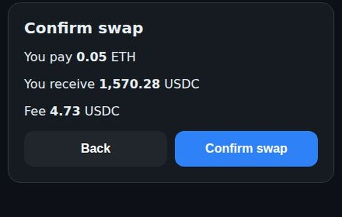
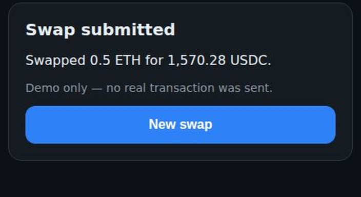

<p></p>

# DappSentinel

**The gate between your dApp and mainnet. Your dApp doesn't ship until Kane says it's safe.**

> [!TIP]
> **TL;DR**
> - **What:** a pre-launch gate for dApp websites. Kane CLI checks the site in a real browser for mistakes you can't see on screen: leaked RPC keys, testnet endpoints, wrong contracts, wrong chain, untrusted scripts, keys in storage.
> - **The loop:** Kane catches it → Claude Code fixes it → Kane checks again, until every check passes. The agent can't edit the checks to cheat.
> - **Real bugs in code we didn't write:** Polaris issue [#118](https://github.com/PolarisQ-xyz/polaris-frontend/issues/118), reported by its maintainers: Kane caught it, Claude fixed it, proven twice, fix [offered upstream](https://github.com/PolarisQ-xyz/polaris-frontend/issues/118#issuecomment-7079526239) ([loop](#real-world-loop-2-a-bug-the-maintainers-reported)). Spark's frontend: a hardcoded RPC key that breaks every build outside Spark's domain ([loop](#real-world-loop-a-bug-in-code-we-didnt-write)).
> - **Kane makes the call:** Kane gives its own verdict on every check, using its DevTools for the hidden ones (they can't read sessionStorage); DappSentinel's exact check runs behind it and catches what Kane misses ([who catches what](#who-catches-what-kane-and-dappsentinel)).
> - **Where it runs:** in Claude Code on your machine (`/sentinel`), and on GitHub, where it blocks the merge and fixes the pull request itself ([#5](https://github.com/Guzman0/DappSentinel/pull/5), no human involved).
> - **Proof, all public:** broken PR blocked ([#2](https://github.com/Guzman0/DappSentinel/pull/2)) · cheating refused ([#6](https://github.com/Guzman0/DappSentinel/pull/6)) · [mutation test](#mutation-test-known-answer-mistakes-it-was-never-tuned-for) 8 of 8 on four runs · [8 live dApps](#real-world-runs) scanned
> - **Install:** `uses: Guzman0/DappSentinel@v1.1.0` or `npm i -g github:Guzman0/DappSentinel` · **Site:** [dappsentinel.netlify.app](https://dappsentinel.netlify.app) · **Video:** [3:59](https://youtu.be/FiErWhY495U)

▶ **[Watch the demo video (3:59)](https://youtu.be/FiErWhY495U)**

## For judges

Every judging rule, and where to see the proof. Everything below is public; nothing needs a login or credits to read.

| Judging rule | Where to see it |
|---|---|
| **Bar: it works end to end** | [Reproduce it yourself](#reproduce-it-yourself) in 7 steps, each with a public run. The published action, used exactly as another repo would, on Lido: [run](https://github.com/Guzman0/DappSentinel/actions/runs/44909812956), 5 of 5, "Clear to ship" |
| **Bar: Kane caught or proved something** | Kane gives its own verdict on all 7 checks: by reading the page, and with its DevTools assertions on network traffic and localStorage. On the demo it failed all 4 hidden checks by itself, and in the mutation test it caught 3 of 4 by itself ([who catches what](#who-catches-what-kane-and-dappsentinel)). Two real bugs in code we didn't write: Spark's hardcoded, domain-locked Alchemy key ([loop 1](#real-world-loop-a-bug-in-code-we-didnt-write)), and Polaris issue #118, reported by its maintainers, where a misconfigured production build silently talks to localhost and testnet ([loop 2](#real-world-loop-2-a-bug-the-maintainers-reported)). 6 planted mistakes caught on the demo ([run](https://github.com/Guzman0/DappSentinel/actions/runs/44757974669), [video at 1:26](https://youtu.be/FiErWhY495U?t=86)). 7 new mistakes it was never tuned for, [8 of 8 on four runs](#mutation-test-known-answer-mistakes-it-was-never-tuned-for). A keyed Alchemy RPC URL found on CoW Swap's live site ([real-world runs](#real-world-runs)) |
| **Bar: the agent and Kane talk** | Kane's findings go straight to Claude Code, and a Stop hook won't let Claude finish while a check fails ([how the loop works](#how-the-loop-works), [video at 1:52](https://youtu.be/FiErWhY495U?t=112)). On GitHub, the fix job hands Claude Kane's report, and the pull request gets a comment with what Claude changed ([PR #7](https://github.com/Guzman0/DappSentinel/pull/7#issuecomment-7052572418)) |
| **Ships** (25%) | Runs in Claude Code (`/sentinel`), from the command line, and as a GitHub Action ([`@v1.1.0`](https://github.com/Guzman0/DappSentinel/releases/tag/v1.1.0)). A required check blocks merging a broken pull request ([PR #2](https://github.com/Guzman0/DappSentinel/pull/2)) |
| **Verified** (25%) | Polaris issue #118: Kane caught the reported bug, Claude fixed it as the issue asks, and the fix is proven twice ([run](https://github.com/Guzman0/DappSentinel/actions/runs/45015619019), [record](evidence/realworld-polaris/)). Spark: Kane caught a real bug, Claude fixed it, Kane proved the fix ([run](https://github.com/Guzman0/DappSentinel/actions/runs/44953030392), [record](evidence/realworld-spark/)). [Mutation test](#mutation-test-known-answer-mistakes-it-was-never-tuned-for) with [Kane's own screenshots](#what-kane-saw-its-own-screenshots) and the full record in [`evidence/mutation-test/`](evidence/mutation-test/). Live mainnet dApps: Lido 6 of 6, Aave 5 of 6, CoW Swap 3 of 5 ([results](#real-world-runs)). Kane's own words are quoted in every report |
| **Closed loop** (25%) | On real code too: Kane's report on Spark's frontend went to Claude Code, which fixed the source, and Kane re-checked the rebuilt site in the same workflow. Locally: Kane fails, Claude fixes, the Stop hook re-runs Kane, round 2 passes 7 of 7. On GitHub, with no human: Kane fails PR #5 6 of 7, Claude fixes and pushes, the PR's own check passes 7 of 7 ([forensic trail](#forensic-trail-the-loop-on-github-step-by-step)). Max 3 rounds, and Claude never undoes what the pull request is for: when only a person can decide, it [hands over to a person](#when-the-loop-gives-up-a-person-takes-over) ([real handover, PR #10](https://github.com/Guzman0/DappSentinel/pull/10#issuecomment-7081463817)). The agent [can't cheat](#the-agent-cant-cheat): editing a check is blocked, and the gate refuses to run ([PR #6](https://github.com/Guzman0/DappSentinel/pull/6)) |
| **Craft** (25%) | Two commands from any folder, with no clone ([try it on any dApp](#try-it-on-any-dapp-from-any-folder)). One line in a workflow: `uses: Guzman0/DappSentinel@v1.1.0` ([use it in your own repo](#use-it-in-your-own-repo)). One config file for your own dApp. Reports mask keys, and raw evidence is never uploaded by default ([SECURITY.md](SECURITY.md)). Honest limits in [what DappSentinel doesn't do](#what-dappsentinel-doesnt-do) |
| **Check it without credits** | `npm test` runs the analyzers on recorded fixtures. The [forensic trail](#forensic-trail-the-loop-on-github-step-by-step), the [track record](#track-record) and [`evidence/mutation-test/`](evidence/mutation-test/) are readable as they are |
| **Dates** | First commit `ed622c0`, 18 Nov 2026, after the 12 Nov start. The history is as written |

## Kane's five jobs

Kane CLI isn't only a test step here. It does five jobs, each with public proof.

1. **The gate.** Every check is a Kane run, and a failing check blocks the pull request or stops Claude from finishing ([PR #2](https://github.com/Guzman0/DappSentinel/pull/2)).
2. **The recorder.** Kane drives a real Chrome and records every request and script. That recording is the evidence the exact checks read, and each finding is traced back to its place in Kane's run ([who catches what](#who-catches-what-kane-and-dappsentinel)).
3. **The explorer.** On dApps it has never seen, Kane works out the screen and uses it like a person: it filled in Lido's stake form and read Aave's USDC market ([Lido run](https://github.com/Guzman0/DappSentinel/actions/runs/44835470086), [Aave run](https://github.com/Guzman0/DappSentinel/actions/runs/44834742720)).
4. **The inspector.** With its own DevTools assertions, Kane gives its own verdict on the problems you can't see on screen: leaked keys, testnet endpoints, untrusted scripts and keys in storage. In run 4 of the mutation test it caught 3 of the 4 by itself ([mutation test](#mutation-test-known-answer-mistakes-it-was-never-tuned-for)).
5. **The re-checker.** After Claude Code fixes something, Kane checks again, independently: locally through the Stop hook, on pull requests ([PR #5](https://github.com/Guzman0/DappSentinel/pull/5)), and on real code from Spark and Polaris ([Spark run](https://github.com/Guzman0/DappSentinel/actions/runs/44953030392), [Polaris run](https://github.com/Guzman0/DappSentinel/actions/runs/45015619019)). If Claude still can't get Kane to pass after 3 rounds, the loop stops and asks a person to look ([handover](#when-the-loop-gives-up-a-person-takes-over)).

## Who catches what: Kane and DappSentinel

Every check gets a verdict from Kane itself. Kane checks what a user can see by reading and using the page. For what a user can't see, Kane uses its own [DevTools assertions](https://www.testmuai.com/docs/kane-cli-checkpoint-devtools) on the network traffic and localStorage it captured. DappSentinel's code then reads Kane's recording line by line as a second, exact check. A check fails if either one finds the problem: a security gate fails closed.

| Check | Kane's own verdict | DappSentinel's exact check |
|---|---|---|
| Wrong contract address | **Kane**, reading the page | |
| Wrong chain ID | **Kane**, reading the network badge | |
| Main flow broken | **Kane**, using the swap like a person | |
| RPC key leaked | **Kane**, DevTools network assertion | Every request in Kane's recording |
| Testnet endpoint | **Kane**, DevTools network assertion | Every request in Kane's recording |
| Untrusted script | **Kane**, DevTools network assertion | Every script in Kane's recording |
| Keys in browser storage | **Kane**, DevTools localStorage assertion | localStorage and sessionStorage of the browser Kane drove |

**How the two verdicts compare, measured, not claimed:**
- **Demo with the six mistakes:** Kane's DevTools assertions failed all 4 hidden checks on their own, and DappSentinel agreed on all 4 ([run](https://github.com/Guzman0/DappSentinel/actions/runs/45023773746)).
- **Mutation test, run 4:** Kane's assertions caught 3 of the 4 hidden mistakes by themselves: the Infura key, the Holesky RPC and the jsDelivr script. The fourth, a seed phrase in sessionStorage, is outside what Kane's DevTools can read (they cover localStorage, not sessionStorage), and DappSentinel's exact check caught it. 8 of 8 judged correctly ([run](https://github.com/Guzman0/DappSentinel/actions/runs/45023763082)).
- **What changed between runs 3 and 4:** Kane's network capture resets at every step, so a script that loads only while the page opens was invisible to an assertion in a later step. Kane now stores the page's requests in the step that reloads it and asserts on that list. That turned Kane's miss on the jsDelivr script into a catch.
- **No false alarms from Kane:** on the clean site, and on Lido's live site, every Kane DevTools verdict matched DappSentinel's ([Lido run](https://github.com/Guzman0/DappSentinel/actions/runs/45023768462)).

That's why both run: Kane's verdicts come from Kane, and the exact check makes sure nothing slips past either. Every report shows both side by side, with a link to Kane's own replay. Each network finding also says where it sits in Kane's run, for example *"first seen in Kane's recording as request 5 of 6"*.

## Real-world loop: a bug in code we didn't write

Spark is a large DeFi lending app. Its web app's code (MIT licence) was public on GitHub in 2024, and [a copy](https://github.com/syt4sh1/spark-app) still is. One workflow, [one run](https://github.com/Guzman0/DappSentinel/actions/runs/44953030392), every job green:

1. **Kane caught it.** We built Spark's code unchanged and Kane used it in a real browser. Kane failed the page itself: *"The page tries to use an external Ethereum data service from the browser, but that service does not allow requests from this page's address. The app cannot load its required data and shows an error screen."* The cause, in the browser's own error: an Alchemy API key written into the source, locked to Spark's domain.
2. **Claude Code fixed it.** It removed the key from the source, made the RPC URL a setting (`VITE_MAINNET_RPC_URL`) with a keyless public fallback, and documented it. 3 lines in 2 files: [the patch](evidence/realworld-spark/run-44953030392/fix.patch).
3. **Kane proved it.** Rebuilt and checked again: the page loads, and none of the 46 requests carries a key or goes to a testnet.

The same key is still in Spark's production traffic: DappSentinel's [live scan of app.spark.fi](https://github.com/Guzman0/DappSentinel/actions/runs/44952359583) found it. Spark's repository is private now, so there's no pull request to offer; the key is masked throughout. To be precise about what kind of bug this is: the key only works from Spark's own domain, so it isn't proof of a leak (see [what DappSentinel doesn't do](#what-dappsentinel-doesnt-do)). The bug is that the published code can't run anywhere else: every fork or self-hosted build shows an error screen until the key is replaced. Full record and honest notes: [`evidence/realworld-spark/`](evidence/realworld-spark/).

## Real-world loop 2: a bug the maintainers reported

[Polaris](https://github.com/PolarisQ-xyz/polaris-frontend) is an open-source prediction-market dApp. Its maintainers' issue [#118](https://github.com/PolarisQ-xyz/polaris-frontend/issues/118) says a production build with a missing setting still builds, and silently points the site at localhost and testnet. One workflow, [one run](https://github.com/Guzman0/DappSentinel/actions/runs/45015619019), every job green:

1. **Kane caught it.** We built Polaris exactly as the issue describes. Kane failed the page: *"The page tried to get market and account data from a local service, but that service was not accepting connections."* Kane's own DevTools assertion against local and testnet requests failed too.
2. **Claude Code fixed it the way the issue asks.** A production build with a missing setting now stops with an error naming it; the defaults stay for development; CI sets explicit values ([the patch](evidence/realworld-polaris/run-45015619019/fix.patch)).
3. **Proven twice.** The misconfigured build is now refused, naming all three settings, which is the issue's first acceptance criterion. A correctly configured build passes Kane's DevTools assertion: no request to localhost or a testnet.

**Offered upstream:** the tested fix is offered [in a comment on issue #118](https://github.com/PolarisQ-xyz/polaris-frontend/issues/118#issuecomment-7079526239) (22 Nov), and the pull request follows once a maintainer assigns it. Full record and honest notes, including why the configured build still can't load Polaris's live data from a test copy: [`evidence/realworld-polaris/`](evidence/realworld-polaris/).

DappSentinel is a pre-launch safety gate for dApp frontends. It uses [Kane CLI](https://github.com/LambdaTest/kane-cli) to open your site in a real browser and check what happens *behind* the page: every network request, every script, everything left in browser storage. When Kane catches a problem, your coding agent (Claude Code) gets the findings, fixes the code, and Kane checks again, until every check passes.

It blocks the release wherever it runs: Claude Code can't finish its turn while a check fails, a pull request gets a red check ([GitHub Action](#use-it-in-your-own-repo)), and `npm run deploy` only deploys when every check passes.

These are the mistakes that look fine on screen and cost users money:

| Check | What gets caught | How Kane proves it |
|---|---|---|
| `rpc-key-leak` | RPC provider API keys (Alchemy, Infura, QuickNode…) in network requests | Network log Kane records in the browser |
| `testnet-rpc` | A mainnet build still calling testnet, staging or localhost endpoints | Network log Kane records in the browser |
| `unknown-scripts` | Scripts loaded from hosts you didn't approve, the way drainers get injected | Network log Kane records in the browser |
| `storage-secrets` | Private keys or seed phrases left in localStorage or sessionStorage | Kane drives a Chrome that DappSentinel watches live |
| `contract-address` | A displayed contract address that doesn't match the real one | Kane asserts on the page |
| `chain-id` | The app pointing at the wrong chain | Kane asserts on the page |
| `swap-flow` | The core user flow breaking after the fixes | Kane runs the flow end to end |

### Why two kinds of check?

Kane is great at plain-English assertions about what's on the page, so the visible checks
(`contract-address`, `chain-id`, `swap-flow`) are Kane's verdicts alone. For the hidden problems,
Kane gives its own verdict with its DevTools assertions on the network requests and localStorage it
captured. DappSentinel's code then checks the same evidence exactly: it reads every request in the
network recording (HAR file) Kane saves, and watches localStorage and sessionStorage live in the
Chrome that Kane drives (`kane-cli --cdp-endpoint`). A check fails if either one finds the problem.
The second check matters because Kane's DevTools can't read sessionStorage and can miss a request,
as the [mutation test](#mutation-test-known-answer-mistakes-it-was-never-tuned-for) shows. Secrets are
masked in the report.

## Why it matters

The demo video opens with three attacks that hit dApp websites, not smart contracts. Together they took about $1.62 billion from users.

| When | What happened | Lost | Source |
|---|---|---|---|
| Dec 2021 | BadgerDAO: a malicious script was injected into the website through a compromised Cloudflare API key | ~$120M | [The Block](https://www.theblock.co/post/126072/defi-protocol-badgerdao-exploited-for-120-million-in-front-end-attack) |
| Dec 2023 | Ledger Connect Kit: a poisoned npm release shipped a wallet drainer into dApps that load the library | ~$600K | [Ledger's incident report](https://www.ledger.com/blog/security-incident-report), [SlowMist](https://slowmist.medium.com/supply-chain-attack-on-ledger-connect-kit-analyzing-the-impact-and-preventive-measures-1005e39422fd) |
| Feb 2025 | Bybit: tampered JavaScript in the Safe{Wallet} web interface altered a multisig transaction | ~$1.5B | [The Block](https://www.theblock.co/post/343530/lazarus-appears-to-compromise-safe-developer-machine-in-lead-up-to-1-5-billion-bybit-hack-report), [SlowMist](https://slowmist.medium.com/bybits-1-5-billion-theft-unveiled-safe-wallet-front-end-code-tampered-84b78f0fa9c2) |

Figures are approximate and in US dollars at the time of each attack.

## Try it on any dApp, from any folder

No clone and no config. You need Node.js 20+, Chrome, and Kane CLI signed in (`npm i -g @testmuai/kane-cli && kane-cli login`):

```bash
npm install -g github:Guzman0/DappSentinel
dappsentinel check --url https://stake.lido.fi
```

It runs the 5 checks that need no inside knowledge of the site and writes `.sentinel/report.md`. This exact install, in an empty folder on a fresh GitHub runner, passed Lido 5 of 5: [run](https://github.com/Guzman0/DappSentinel/actions/runs/44925440855). `dappsentinel --help` lists the rest.

## Try it yourself in a minute

**Live demo dApp (deliberately vulnerable, the scan target):** https://sentinelswap-demo.netlify.app

This is SentinelSwap, the site DappSentinel checks, with all six mistakes still in it. It is not DappSentinel itself: DappSentinel runs from this repo, locally or in GitHub Actions.

It looks like a normal swap page. Open your browser's developer tools and you'll find the Alchemy key in the network tab, the unpkg script, the Sepolia RPC and `wallet_pk` in localStorage. Or let DappSentinel find them:

```bash
npm run sentinel -- --url https://sentinelswap-demo.netlify.app
```

Both secrets on that page are fake: the Alchemy key was made up and the private key is the public Hardhat test key.

## How the loop works

```
 Claude Code edits the site
          │
          ▼
 Stop hook runs DappSentinel ──► Kane CLI checks the site in a real browser
          ▲                                   │
          │                         all pass? ├── yes ──► ✅ clear to ship
          │                                   │
          └──── Kane's findings + fix hints ◄─┘ no
```

1. You (or Claude) change the site.
2. When Claude finishes its turn, a Claude Code **Stop hook** (`hooks/sentinel-stop.js`) runs every check with Kane CLI.
3. If anything fails, the hook **blocks Claude from finishing** and hands it Kane's report (`.sentinel/report.md`): what failed, the offending URLs or values, and how to fix it.
4. Claude fixes the code and finishes again, which re-runs the checks. This repeats until everything passes (or 5 rounds).
5. `npm run deploy` only deploys if every check passes.

## The agent can't cheat

The coding agent is allowed to fix the site. It is not allowed to touch the referee.

- A Claude Code **PreToolUse hook** (`hooks/guard-checks.js`) blocks any edit to `checks/`, `sentinel.config.json`, `bin/`, `lib/`, `hooks/` or `.claude/`, whether through the edit tools or a shell command like `sed -i` or `Set-Content`.
- The gate runs a **tamper check** first: if any of those files differ from the last commit, it refuses to run (exit code `3`) and lists them, and the Stop hook tells the agent to revert them.

So a red check can only turn green by changing the site.

## When the loop gives up, a person takes over

The fix loop never tries forever, and it never quietly undoes what a developer meant to do. Claude Code is told what the pull request is for and to keep it. If the only way to pass a check is to undo that, or to make a decision only a person may make (like trusting a new script host), it makes no change and explains why. DappSentinel then comments on the pull request: a person needs to look, here are the checks still failing, Claude's reasoning, and Kane's run. The same happens after 3 rounds of fixes that Kane still fails, on GitHub and in the local Stop hook (`hooks/sentinel-stop.js`, 3 rounds).

**A real handover, [PR #10](https://github.com/Guzman0/DappSentinel/pull/10)** (closed, not merged). Nothing simulated: Claude had its normal 40 steps. The pull request adds TradingView's live price ticker to the swap page. Kane failed 2 of 7 checks: the ticker loads 21 scripts from TradingView's servers, which aren't trusted. Claude kept the ticker, didn't touch the rules, and [explained](https://github.com/Guzman0/DappSentinel/pull/10#issuecomment-7081463817) that trusting TradingView is a decision for a person ([run](https://github.com/Guzman0/DappSentinel/actions/runs/45038933982)). It also flagged one of the two failures as a likely false alarm: the widget puts the page's own address (`localhost`, in this test) into a request, and the testnet check matched it. We have left that check as it is and list it under [what DappSentinel doesn't do](#what-dappsentinel-doesnt-do).

**The 3-round limit, [PR #9](https://github.com/Guzman0/DappSentinel/pull/9)** (closed, not merged). Here the three fix rounds are **simulated** with empty commits, because we couldn't make Claude fail three times for real: in [PR #8](https://github.com/Guzman0/DappSentinel/pull/8), given only 4 steps per round instead of 40 (the `handover-test` label), it still fixed all six mistakes in round 1. On PR #9 the fix job counted 3 rounds, made no more fixes and [handed over](https://github.com/Guzman0/DappSentinel/pull/9#issuecomment-7081219978) with the six checks still failing ([run](https://github.com/Guzman0/DappSentinel/actions/runs/45037005761)).

## Quick start

You need [Node.js 20+](https://nodejs.org), Google Chrome and a free [TestMu AI](https://www.testmuai.com/kane-cli/) account.

```bash
# 1. Install Kane CLI and sign in
npm install -g @testmuai/kane-cli
kane-cli login

# 2. Get DappSentinel
git clone https://github.com/Guzman0/DappSentinel.git
cd DappSentinel
npm install

# 3. Run the gate against the included demo dApp
npm run sentinel
```

The demo dApp (`demo-dapp/`, a simulated ETH → USDC swap page) ships with real-world mistakes in it, so the first run fails and shows you what Kane catches. Open `.sentinel/report.md` to see the findings.

### Close the loop with Claude Code

```bash
npx @testmuai/kane-cli-skill   # optional: teaches Claude Code how to use Kane
claude                          # open Claude Code in this folder
```

Then ask: *"Run /sentinel and fix everything Kane catches."* Or change anything in `demo-dapp/` and let the Stop hook take over.

Want to watch Kane work? `npm run sentinel:headed` runs the checks in a visible browser.

## Use it on your own dApp

1. Point `siteDir` in `sentinel.config.json` at your site's build folder, or set `url` to your staging URL.
2. Set what "correct" means for your app:

```json
{
  "url": "https://staging.yourdapp.xyz",
  "chainId": 1,
  "networkName": "Ethereum",
  "contracts": { "USDC": "0xA0b86991c6218b36c1d19D4a2e9Eb0cE3606eB48" },
  "allowedScriptHosts": ["self", "cdn.yourdapp.xyz"]
}
```

3. Adjust the steps in `checks/*.md` to match your app's UI. Kane checks are plain English, so no test code is needed. `{{placeholders}}` are filled in from the config. Make sure `checks/07-swap-flow.md` walks through your main flow, because the network checks scan the traffic Kane records during it.

## Check any live dApp

The `live` profile runs the checks that work on any public site, with no access to its code: leaked RPC keys, testnet endpoints, untrusted scripts and secrets in browser storage. Kane browses the page while DappSentinel reads the traffic and storage.

```bash
node bin/dappsentinel.js check --config profiles/live --url https://app.yourdapp.xyz
```

Add the hosts you trust to `allowedScriptHosts` in `profiles/live/sentinel.config.json`, or every third-party script will be flagged.

## Use it in your own repo

DappSentinel is a GitHub Action. Add your TestMu AI username and access key as repository secrets (`LT_USERNAME`, `LT_ACCESS_KEY`), then add one step to a workflow:

```yaml
- uses: Guzman0/DappSentinel@v1.1.0
  with:
    url: https://staging.yourdapp.xyz
    lt-username: ${{ secrets.LT_USERNAME }}
    lt-access-key: ${{ secrets.LT_ACCESS_KEY }}
```

The step fails while any check fails, writes the report to the run summary and keeps it as an artifact. Other inputs:

- `site-dir`: check a folder you built (for example `dist`) instead of a URL. DappSentinel serves it locally.
- `config`: your own `sentinel.config.json`, with your chain ID, contract addresses and trusted script hosts, plus a `checksDir` for checks written for your UI. Without it, the `live` checks run, which work on any site.

If you pass `config` and check out with `fetch-depth: 0`, a pull request that changes your config or checks is refused, so a PR can't loosen the rules it is checked against.

## Why Kane CLI, and not Playwright plus a parser

A fair question: the network and storage checks read files. Couldn't a scripted browser produce them?

For one site you wrote the script for, yes. What a script can't do is use a dApp it has never seen. Kane takes a plain-English objective and works the page out for itself, so the same checks run on any dApp with no per-site code:

- **On Aave's USDC market**, Kane found and dismissed a notice banner on its own, then confirmed the page is USDC on Ethereum and shows a supply APY and the total supplied ([run](https://github.com/Guzman0/DappSentinel/actions/runs/44834742720)). Nobody wrote selectors for that page.
- **On Lido's stake screen**, Kane dismissed Lido's banner, filled in the stake form and confirmed it quotes 1 ETH = 1 stETH, shows an APR and says it's on Ethereum ([run](https://github.com/Guzman0/DappSentinel/actions/runs/44835470086)).
- **On the demo**, Kane runs the swap and judges what the page shows: the contract address, the chain on the network badge, the confirmation. These are Kane's verdicts, not string matches.

Kane does three jobs here:

1. **It decides what passes.** Contract address, chain ID, the swap flow and the live-dApp screens are Kane assertions (`checks/03`, `04`, `07`, and `profiles/lido`, `profiles/aave`).
2. **It produces the evidence.** The network and storage checks read what Kane recorded while it used the page like a person. The recording only means something because a real user flow happened.
3. **It tells the agent what's wrong.** Kane's verdicts and summaries are what Claude Code reads before it fixes the site.

When Kane can't reach the real page (Lido's bot protection challenged GitHub's runner once), DappSentinel reports the checks as inconclusive instead of guessing ([run](https://github.com/Guzman0/DappSentinel/actions/runs/44834739399)).

## Forensic trail: the loop on GitHub, step by step

Every claim about the closed loop, with the artifact that proves it. From [PR #7](https://github.com/Guzman0/DappSentinel/pull/7), a copy change made on top of the broken demo:

| Step | What happened | Evidence |
|---|---|---|
| 1 | Kane fails the pull request: 6 of 7 | [The `gate` job](https://github.com/Guzman0/DappSentinel/actions/runs/44831840406/job/136618434622) |
| 2 | Claude Code receives Kane's report | [The `fix` job](https://github.com/Guzman0/DappSentinel/actions/runs/44831840406/job/136620210863): it downloads the gate's report, the prompt is in the log, and Claude's steps are in the run summary |
| 3 | Claude changes the site, and only the site | [The fix commit](https://github.com/Guzman0/DappSentinel/commit/f89938ad734d4633e7c2760f21d897dff42998c7): 2 files, both in `demo-dapp/` |
| 4 | Claude explains what it changed | [Its summary on the PR](https://github.com/Guzman0/DappSentinel/pull/7#issuecomment-7052572418), redacted like every report |
| 5 | Kane checks again and passes: 7 of 7 | [The re-check](https://github.com/Guzman0/DappSentinel/actions/runs/44833318875) |
| 6 | The agent can't change the rules | The `fix` job refuses to commit anything outside `demo-dapp/`. And in [PR #6](https://github.com/Guzman0/DappSentinel/pull/6), a check was edited instead of the site: the gate [refused to run](https://github.com/Guzman0/DappSentinel/actions/runs/44831572149), the auto-fix never started, and the merge stays blocked |

Honest note: PR #7's first re-check ([run](https://github.com/Guzman0/DappSentinel/actions/runs/44832463609)) failed because Kane pressed Confirm swap before checking the confirmation, and DappSentinel then treated the valid network results as unproven. Both were fixed ([commit](https://github.com/Guzman0/DappSentinel/commit/72c2bac)) before the passing re-check. [PR #5](https://github.com/Guzman0/DappSentinel/pull/5) shows the same loop with no interruption.

## Reproduce it yourself

Each step says what you should see, and links a public run where it already happened.

| Step | Command | Expected result | Public run |
|---|---|---|---|
| 1. Check the broken demo | `npm install` → `kane-cli login` → `npm run sentinel` | ❌ 6 of 7 checks fail (only the swap flow passes), exit code 1 | [main, 6 of 7 failed](https://github.com/Guzman0/DappSentinel/actions/runs/44757974669) |
| 2. Let Claude Code fix it | Open the folder in Claude Code and run `/sentinel` | Claude fixes `demo-dapp/`, the Stop hook re-runs Kane, round 2 passes 7 of 7 | Shown in the [demo video](https://youtu.be/FiErWhY495U); the same fixes are in [PR #1](https://github.com/Guzman0/DappSentinel/pull/1) |
| 3. Try to cheat | Ask Claude to edit `checks/04-chain-id.md`, or edit it yourself and run `npm run sentinel` | The edit is blocked; or the gate refuses to run (exit code 3) | Shown in the [demo video](https://youtu.be/FiErWhY495U) |
| 4. Fix in a pull request | Open a PR that fixes `demo-dapp/` | The `gate` check passes 7 of 7 | [PR #1, 7 of 7 passed](https://github.com/Guzman0/DappSentinel/actions/runs/44756869916) |
| 5. Break in a pull request | Open a PR that leaves the mistakes in | The `gate` check fails and the required check blocks the merge | [PR #2, 6 of 7 failed](https://github.com/Guzman0/DappSentinel/actions/runs/44794168901), merge blocked |
| 6. Let Claude fix it on GitHub | Open a PR that leaves the mistakes in, with `CLAUDE_CODE_OAUTH_TOKEN` set | The gate fails, Claude Code commits a fix to the PR, the gate re-runs and passes 7 of 7 | [PR #5](https://github.com/Guzman0/DappSentinel/pull/5): [red](https://github.com/Guzman0/DappSentinel/actions/runs/44819169522), then [green](https://github.com/Guzman0/DappSentinel/actions/runs/44819910638) |
| 7. Check a live dApp | `node bin/dappsentinel.js check --config profiles/live --url https://stake.lido.fi` | ✅ 5 of 5 pass | [Lido via the action](https://github.com/Guzman0/DappSentinel/actions/runs/44776723947) |

Reset the demo after step 2 with `npm run demo:reset`.

## Track record

Every CI run so far, unfiltered. Same input, same verdict.

| Input | Runs | Result |
|---|---|---|
| Demo with the six mistakes (`main`, PR #2) | [1](https://github.com/Guzman0/DappSentinel/actions/runs/44757974669), [2](https://github.com/Guzman0/DappSentinel/actions/runs/44777482670), [3](https://github.com/Guzman0/DappSentinel/actions/runs/44794168901) | ❌ 6 of 7 failed, every time |
| Demo with the fixes (PR #1) | [1](https://github.com/Guzman0/DappSentinel/actions/runs/44756869916), [2](https://github.com/Guzman0/DappSentinel/actions/runs/44777479949) | ✅ 7 of 7 passed, every time |
| Demo fixed by Claude Code on GitHub (PR #3, PR #5) | [#3 red](https://github.com/Guzman0/DappSentinel/actions/runs/44812319363) → [#3 green](https://github.com/Guzman0/DappSentinel/actions/runs/44813042427), [#5 red](https://github.com/Guzman0/DappSentinel/actions/runs/44819169522) → [#5 green](https://github.com/Guzman0/DappSentinel/actions/runs/44819910638) | ❌ 6 of 7, then ✅ 7 of 7 after Claude's fix, both times |
| Mutation test (known-answer): fixed site + 7 new mistakes | [1](https://github.com/Guzman0/DappSentinel/actions/runs/44847434698), [2](https://github.com/Guzman0/DappSentinel/actions/runs/44884542975) | ✅ 8 of 8 judged correctly, both times |
| An edited check (PR #6) | [1](https://github.com/Guzman0/DappSentinel/actions/runs/44831572149) | ⛔ refused to run, auto-fix not started |
| Lido | [1](https://github.com/Guzman0/DappSentinel/actions/runs/44762327264), [2](https://github.com/Guzman0/DappSentinel/actions/runs/44771371726), [3](https://github.com/Guzman0/DappSentinel/actions/runs/44776723947) | ✅ 5 of 5, every time since the "self" fix |
| CoW Swap | [1](https://github.com/Guzman0/DappSentinel/actions/runs/44760471120), [2](https://github.com/Guzman0/DappSentinel/actions/runs/44762331502) | ❌ keyed RPC URL and outside script hosts, both times |
| Aave | [1](https://github.com/Guzman0/DappSentinel/actions/runs/44759641283), [2](https://github.com/Guzman0/DappSentinel/actions/runs/44760476608) | ❌ scripts from `app.family.co` and Cloudflare Insights, both times |

Not counted above, and why: one Lido run ([run](https://github.com/Guzman0/DappSentinel/actions/runs/44770797794)) hit Cloudflare bot protection, which led to the "inconclusive" rule; one action test ([run](https://github.com/Guzman0/DappSentinel/actions/runs/44770752102)) ran before the `v1` tag existed; the first runs on Lido, CoW Swap and Aave ([1](https://github.com/Guzman0/DappSentinel/actions/runs/44759647200), [2](https://github.com/Guzman0/DappSentinel/actions/runs/44759652548)) were before two false-alarm fixes, described in [Real-world runs](#real-world-runs).

## Mutation test (known-answer): mistakes it was never tuned for

A gate is only useful if it's right. So we took the fixed site and made 7 copies, each with **one new mistake** that is different from the demo's (Infura instead of Alchemy, Holesky instead of Sepolia, a swapped digit in the middle of the address instead of the last one, and so on). The clean site must pass everything; each copy must fail exactly its own check and nothing else.

**Four runs, same verdict every time: 8 of 8** ([run 1](https://github.com/Guzman0/DappSentinel/actions/runs/44847434698) · [run 2](https://github.com/Guzman0/DappSentinel/actions/runs/44884542975) · [run 3](https://github.com/Guzman0/DappSentinel/actions/runs/44962415067) · [run 4](https://github.com/Guzman0/DappSentinel/actions/runs/45023763082)). Runs 3 and 4 also record Kane's own DevTools verdicts on the 4 hidden mistakes. In run 3 Kane caught 2 of them by itself and missed the jsDelivr script and the seed in sessionStorage. We fixed how Kane captures the page's requests, and in run 4 it caught 3 of 4. Kane's DevTools can't read sessionStorage, so that one is always caught by DappSentinel's exact check.


| Variant | Planted mistake | Expected | Run 1 | Run 2 | Run 3 | Run 4 | What Kane found |
|---|---|---|---|---|---|---|---|
| `clean` | None: the fixed site | 7 of 7 pass | ✅ | ✅ | ✅ | ✅ | Completed the swap; address and chain ID confirmed |
| `m1-infura-key` | Infura RPC URL with an API key | fail `rpc-key-leak` only | ✅ | ✅ | ✅ | ✅ | `POST mainnet.infura.io/v3/3f9c…a65` in its network recording |
| `m2-holesky-rpc` | Holesky testnet RPC in a mainnet build | fail `testnet-rpc` only | ✅ | ✅ | ✅ | ✅ | A request to `ethereum-holesky-rpc.publicnode.com` |
| `m3-swapped-digits` | Two characters swapped mid USDC address | fail `contract-address` only | ✅ | ✅ | ✅ | ✅ | Failed it both times, but its written reason was about its own step (see below) |
| `m4-polygon-chain` | Chain ID 137 under an Ethereum label | fail `chain-id` only | ✅ | ✅ | ✅ | ✅ | "showing the chain ID for a different network while keeping the Ethereum name" |
| `m5-jsdelivr-script` | Script from the jsDelivr CDN | fail `unknown-scripts` only | ✅ | ✅ | ✅ | ✅ | 1 script from 1 untrusted host, `cdn.jsdelivr.net` |
| `m6-seed-in-session` | Seed phrase in sessionStorage as `backup` | fail `storage-secrets` only | ✅ | ✅ | ✅ | ✅ | `sessionStorage["backup"]` holds a seed phrase |
| `m7-wrong-confirm-amount` | Confirm screen shows a tenth of the amount | fail `swap-flow` only | ✅ | ✅ | ✅ | ✅ | The decimal point is in the wrong place; received amount and fee still match 0.5 ETH |

### What Kane saw (its own screenshots)

Cropped from Kane's step screenshots in run 2. The full, uncropped sets are in [`evidence/mutation-test/run-44884542975/`](evidence/mutation-test/run-44884542975/).

| | |
|---|---|
| <br><sub>**m3:** the USDC address on the page reads `…c6218b63c1…`. The real one is `…c6218b36c1…`. Kane failed the address check.</sub> | <br><sub>**m4:** the badge says Ethereum but Chain ID 137. Kane: "showing the chain ID for a different network while keeping the Ethereum name."</sub> |
| <br><sub>**m7:** the user typed 0.5 ETH, the confirmation says 0.05, while the 1,570.28 USDC received still matches 0.5. Kane failed the swap flow.</sub> | <br><sub>**clean:** the fixed site. Kane completed the swap: "Swapped 0.5 ETH for 1,570.28 USDC."</sub> |

**Honest note on m3:** the verdict is right and repeatable (fail on the swapped address, pass on the clean one, twice each), but Kane never wrote "these two characters differ". Both times it said its own comparison step hadn't stored the value it read. We count the verdict, not the explanation.

**The full record**, kept in the repo after GitHub's artifacts expire: [`evidence/mutation-test/`](evidence/mutation-test/) has, for every variant, the report, every step Kane took, Kane's screenshots and the masked network log. Run 2's record was committed by the workflow itself. Run it yourself from the **Mutation test (known-answer)** workflow, or one variant at a time with `node scripts/mutants.js build <id>` and `node bin/dappsentinel.js check --site .mutants/<id>`.

## Real-world runs

The `live` profile, run from GitHub Actions on three live mainnet dApps on 20 Nov 2026. Each run is public: open it to see Kane's output.

| dApp | Result | What Kane's recording showed |
|---|---|---|
| [Lido](https://stake.lido.fi) | ✅ 5 of 5 passed ([run](https://github.com/Guzman0/DappSentinel/actions/runs/44762327264)) | 54 requests and 26 scripts, all clean. Nothing secret in browser storage. |
| Lido, with Kane using the stake screen (`profiles/lido`) | ✅ 6 of 6 passed ([run](https://github.com/Guzman0/DappSentinel/actions/runs/44835470086)) | Kane filled in the stake form and confirmed 1 ETH = 1 stETH, an APR, and Ethereum as the network. Then all 54 requests and 26 scripts were clean. |
| Aave, with Kane using the USDC market (`profiles/aave`) | 5 of 6 ([run](https://github.com/Guzman0/DappSentinel/actions/runs/44834742720)) | Kane confirmed USDC on Ethereum with a supply APY and total supplied. 202 requests with no keys or testnets; scripts from `app.family.co` and Cloudflare Insights as before. |
| [Aave](https://app.aave.com) | 4 of 5 ([run](https://github.com/Guzman0/DappSentinel/actions/runs/44760476608)) | 222 requests with no RPC keys or testnet endpoints. Scripts load from `app.family.co` and Cloudflare Insights. Family is Aave's own embedded-wallet infrastructure, so this flag only means it isn't on the allowlist. |
| [CoW Swap](https://swap.cow.fi) | 3 of 5 ([run](https://github.com/Guzman0/DappSentinel/actions/runs/44762331502)) | One request goes to an Alchemy RPC URL with an API key in it (masked in the report). Frontends often ship domain-restricted keys on purpose, so this is a prompt to check the key's restrictions, not proof of a leak. 14 scripts come from 11 outside hosts, mostly ads and analytics. |

**A wider sweep, 21 Nov 2026:** 8 more dApps whose website code is open source, same `live` profile.

| dApp | Result | What Kane's recording showed |
|---|---|---|
| [Spark](https://app.spark.fi) | 4 of 5 ([run](https://github.com/Guzman0/DappSentinel/actions/runs/44952359583)) | A request to an Alchemy RPC URL with the full API key in it (masked here), first seen as request 28 of 80. The same key is written into Spark's frontend code, which was public on GitHub under an MIT licence in 2024. |
| [Yearn](https://yearn.fi) | ✅ 5 of 5 ([run](https://github.com/Guzman0/DappSentinel/actions/runs/44951344497)) | 80 requests and 29 scripts, all clean |
| [Curve](https://www.curve.finance/dex/ethereum/swap) | ✅ 5 of 5 ([run](https://github.com/Guzman0/DappSentinel/actions/runs/44951350211)) | 199 requests and 177 scripts, all clean |
| [Uniswap](https://app.uniswap.org/swap) | 4 of 5 ([run](https://github.com/Guzman0/DappSentinel/actions/runs/44951361382)) | 1,002 requests with no keys or testnets. One script from Cloudflare Turnstile, its bot protection |
| [ENS](https://app.ens.domains) | 4 of 5 ([run](https://github.com/Guzman0/DappSentinel/actions/runs/44951371955)) | Clean traffic. Scripts from Cloudflare Insights and Intercom (support chat) |
| [Revoke.cash](https://revoke.cash) | 4 of 5 ([run](https://github.com/Guzman0/DappSentinel/actions/runs/44951383161)) | Clean traffic. Scripts from Cloudflare Insights and Crisp (support chat) |
| [Balancer](https://balancer.fi/swap/ethereum) | ⚠️ inconclusive ([run](https://github.com/Guzman0/DappSentinel/actions/runs/44951366707)) | The site's bot protection blocked the automated browser, so the network checks were marked inconclusive instead of passed |
| [Sushi](https://www.sushi.com/ethereum/swap) | ⚠️ inconclusive ([run](https://github.com/Guzman0/DappSentinel/actions/runs/44951355988)) | Kane stopped because the page couldn't scroll, which our browse instruction made conditional. Inconclusive, not passed |

Analytics, support-chat and bot-protection scripts are flagged because they aren't on the allowlist, not because they're malicious: a team adds the hosts it trusts to `allowedScriptHosts`.

Running on real sites made DappSentinel better:
- An early storage check mistook order hashes for private keys.
- "self" now trusts a site's own subdomains (`matomo.lido.fi` for `stake.lido.fi`).
- `app.spark.fi` forwards to `app.spark.finance`. The [first Spark run](https://github.com/Guzman0/DappSentinel/actions/runs/44951377736) flagged all 24 of Spark's own scripts and missed its storage. DappSentinel now follows the forward and counts the new address as the site itself; the [re-run](https://github.com/Guzman0/DappSentinel/actions/runs/44952359583) flags only the real key.

The demo itself also runs in CI: [`main` with the six mistakes](https://github.com/Guzman0/DappSentinel/actions/runs/44757974669) fails 6 of 7, and [the fix in PR #1](https://github.com/Guzman0/DappSentinel/actions/runs/44756869916) passes 7 of 7.

## Run it in CI

`.github/workflows/dappsentinel.yml` runs the gate on every pull request. The PR gets a red check while any check fails, the report appears in the run summary, and Kane's evidence is kept as an artifact.

**The loop closes on GitHub too.** When the gate fails on a pull request, Claude Code fixes the site in CI, commits the fix to the pull request, and Kane checks again. Only `demo-dapp/` may change (the workflow refuses to commit anything else, and the gate refuses edited rules), and it stops after 3 rounds. It needs one more secret, `CLAUDE_CODE_OAUTH_TOKEN`, made with `claude setup-token`. Add `DAPPSENTINEL_PUSH_TOKEN` too (a fine-grained token with Contents and Pull requests write access to this repo) and the fix commit starts the pull request's own gate, so the loop runs with no clicks at all. See it in [PR #5](https://github.com/Guzman0/DappSentinel/pull/5): Kane failed it 6 of 7, Claude Code fixed it on GitHub, and the PR's gate passed 7 of 7.

1. Add two repository secrets under **Settings > Secrets and variables > Actions**: `LT_USERNAME` (your TestMu AI username) and `LT_ACCESS_KEY` (your access key). In CI, Kane signs in with these instead of `kane-cli login`.
2. Open a pull request.

To check a live dApp from GitHub, open **Actions → DappSentinel → Run workflow** and paste its URL. That runs the `live` profile on it.

The referee is protected in CI too. If a pull request changes the checks, a config or the gate itself, DappSentinel compares them with the branch the PR targets and refuses to run, so a PR can't edit a check to pass its own gate.

## Commands

| Command | What it does |
|---|---|
| `npm run sentinel` | Run every check, write `.sentinel/report.md` and `.sentinel/report.json` |
| `npm run sentinel:headed` | Same, with a visible browser |
| `npm run sentinel -- --only rpc-key-leak,chain-id` | Run selected checks |
| `npm run demo` | Serve the demo dApp at http://localhost:4173 |
| `npm run demo:reset` | Put the six planted mistakes back after a fix |
| `npm run checks` | List the checks |
| `node bin/dappsentinel.js check --config profiles/live --url <url>` | Check any public dApp URL |
| `npm run deploy` | Run the gate, and deploy to Netlify only if it passes |

Exit codes: `0` all passed, `1` a check failed, `2` setup problem (Kane not installed or not signed in), `3` refused because the checks or the gate were changed.

Turn the Stop hook off for a session with `DAPPSENTINEL_HOOK=off`.

## What DappSentinel doesn't do

For what DappSentinel collects, masks and uploads, see [SECURITY.md](SECURITY.md). In short: only a redacted report is kept, and Kane's raw evidence is never uploaded unless you opt in.

- **A flagged RPC key isn't proof of a leak.** Many dApps ship keys that only work from their own domain. Treat the finding as a prompt to check the key's restrictions.
- **A flagged script host isn't proof of an attack.** It means the host isn't on your allowlist. Look into it, then either trust it in your config or remove the script.
- **It isn't a smart contract audit.** It checks the website, not the contracts behind it.
- **It can't catch every frontend compromise.** It sees what the browser does while Kane uses the page. Malicious code that only wakes up for certain wallets or transactions, like the code in the Bybit attack, may stay quiet during a check.
- **Some sites block automated browsers.** When Kane can't reach the real page, DappSentinel reports the network checks as inconclusive, never as clean.
- **Testing on `localhost` can trip the testnet check.** It matches words like `localhost` anywhere in a request's address, including where a third-party widget sends the page's own address, as in [PR #10](https://github.com/Guzman0/DappSentinel/pull/10). Check a deployed preview to avoid it.

## Notes

- A full round is 4 Kane CLI runs and uses TestMu AI credits. New accounts get free credits.
- `npm test` runs the analyzers against a network log recorded by Kane, with no credits needed.
- Both secrets in the demo are fake on purpose: the Alchemy key was made up, and the private key is the public Hardhat test key (account #0). Never use it for real funds.
- Kane CLI's DevTools assertions read localStorage but not sessionStorage. DappSentinel reads both from the Chrome that Kane drives, so a key hidden in sessionStorage is still caught.
- DappSentinel checks what a browser can see. It doesn't replace a smart contract audit.

Built for the [Kane CLI Online Hackathon](https://www.kaneclihack.sh/) with Claude Code; Kane CLI verifies it, and Kane's result drives the fix. MIT licence.
