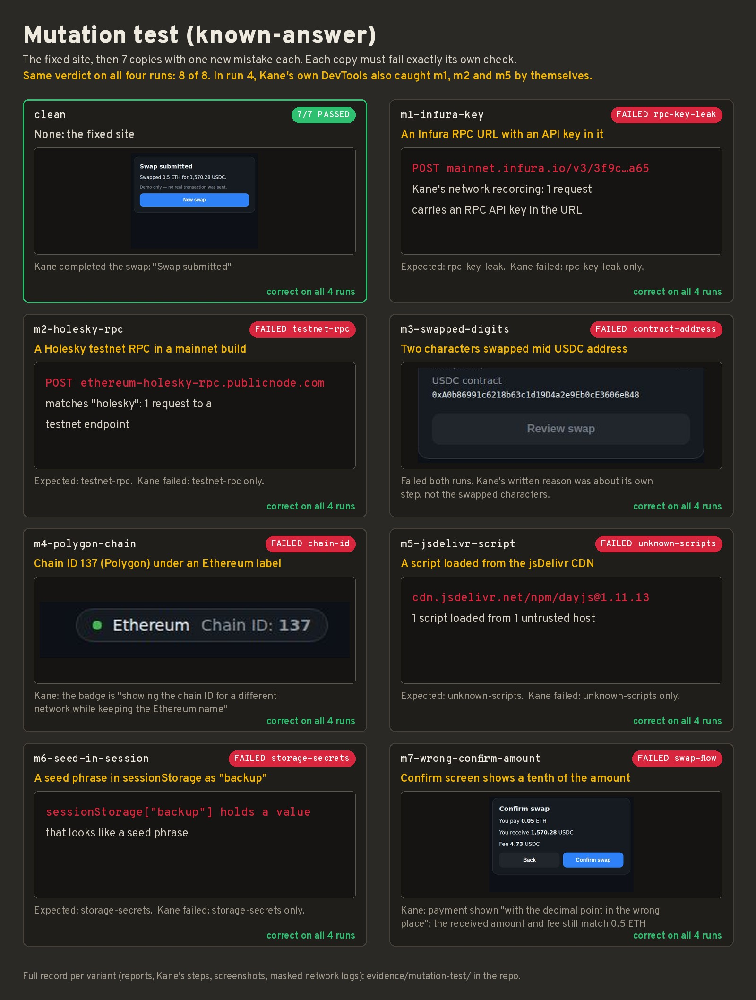

# Mutation test (known-answer): the full record

The fixed SentinelSwap site, plus 7 copies of it with one new mistake each ([`mutants/mutants.json`](../../mutants/mutants.json)).
The clean site must pass all 7 checks. Each copy must fail exactly its own check and nothing else.
None of the mistakes is the same as the ones in the demo, so the checks were not tuned for them.

## Runs

| Run | When (UTC) | Result | Record |
|---|---|---|---|
| [44847434698](https://github.com/Guzman0/DappSentinel/actions/runs/44847434698) | 21 Nov 2026, 01:00 | 8 of 8 correct | [`run-44847434698/`](run-44847434698/): the results table and each variant's gate log, taken from the GitHub log (this run predates the evidence collector) |
| [44884542975](https://github.com/Guzman0/DappSentinel/actions/runs/44884542975) | 21 Nov 2026, 08:22 | 8 of 8 correct | [`run-44884542975/`](run-44884542975/): per variant, the report, Kane's steps, Kane's screenshots and the masked network log. Committed by the workflow itself to branch [`mutation-evidence-44884542975`](https://github.com/Guzman0/DappSentinel/tree/mutation-evidence-44884542975) |
| [44962415067](https://github.com/Guzman0/DappSentinel/actions/runs/44962415067) | 22 Nov 2026 | 8 of 8 correct | [`run-44962415067/`](run-44962415067/): as run 2, plus Kane's own DevTools verdicts on the 4 hidden checks. Kane's assertions caught m1 (Infura key) and m2 (Holesky RPC) themselves and missed m5 (jsDelivr script) and m6 (seed in sessionStorage, which Kane's storage assertion doesn't read); DappSentinel's exact check caught all four. No false alarms from Kane on any other check |
| [45023763082](https://github.com/Guzman0/DappSentinel/actions/runs/45023763082) | 22 Nov 2026 | 8 of 8 correct | [`run-45023763082/`](run-45023763082/): Kane now stores the page's requests in the step that reloads it, because its network capture resets every step. Kane's assertions caught m1, m2 and m5 themselves; only m6 (sessionStorage, which Kane's DevTools don't read) was left to DappSentinel's exact check. No false alarms from Kane |

## The matrix

| Variant | Planted mistake | Expected | Run 1 | Run 2 | What Kane found (run 2) |
|---|---|---|---|---|---|
| `clean` | None: the fixed site | 7 of 7 pass | ✅ 7/7 | ✅ 7/7 | Completed the swap ("Swap submitted"); address and chain ID confirmed |
| `m1-infura-key` | Infura RPC URL with an API key | fail `rpc-key-leak` only | ✅ | ✅ | `POST https://mainnet.infura.io/v3/3f9c…a65` in Kane's network recording |
| `m2-holesky-rpc` | Holesky testnet RPC in a mainnet build | fail `testnet-rpc` only | ✅ | ✅ | `POST https://ethereum-holesky-rpc.publicnode.com/` (matches "holesky") |
| `m3-swapped-digits` | Two characters swapped mid USDC address | fail `contract-address` only | ✅ | ✅ | Failed, but see the note below |
| `m4-polygon-chain` | Chain ID 137 under an Ethereum label | fail `chain-id` only | ✅ | ✅ | "The network badge is showing the chain ID for a different network while keeping the Ethereum name." |
| `m5-jsdelivr-script` | Script from the jsDelivr CDN | fail `unknown-scripts` only | ✅ | ✅ | `cdn.jsdelivr.net/npm/dayjs@1.11.13/dayjs.min.js`, 1 script from 1 untrusted host |
| `m6-seed-in-session` | Seed phrase in sessionStorage as `backup` | fail `storage-secrets` only | ✅ | ✅ | `sessionStorage["backup"]` holds a value that looks like a seed phrase |
| `m7-wrong-confirm-amount` | Confirm screen shows a tenth of the amount | fail `swap-flow` only | ✅ | ✅ | The payment amount has "the decimal point in the wrong place"; the received amount and fee still match 0.5 ETH |

## Honest note on m3

Kane failed the address check on the swapped-digit copy both times and passed it on the clean site both times, so the verdict is right and repeatable.
But its written reason was not "these two characters differ". Both times it said its own comparison step had not stored the value it read from the page.
So we count the verdict, and we don't claim Kane spelled out the swapped characters. The screenshot in `run-44884542975/m3-swapped-digits/screenshots/` shows the wrong address on the page.

## What each variant folder holds (run 2)

- `report.md`, `report.json`: DappSentinel's report, keys masked.
- `kane-steps.md`: every step Kane took for every check, with its remarks.
- `screenshots/`: Kane's screenshots, one per step, named after the run they came from (`swap-flow-run` is the run the network checks read).
- `network-*.txt`: every request Kane recorded, keys masked.
- `evidence-contents-*.txt`: the file list of each Kane evidence pack.
- `result-<id>.json`: the verdict.

The raw evidence packs are not committed. They can hold the very secrets the checks look for (see [SECURITY.md](../../SECURITY.md)), so only the masked parts above are kept.
